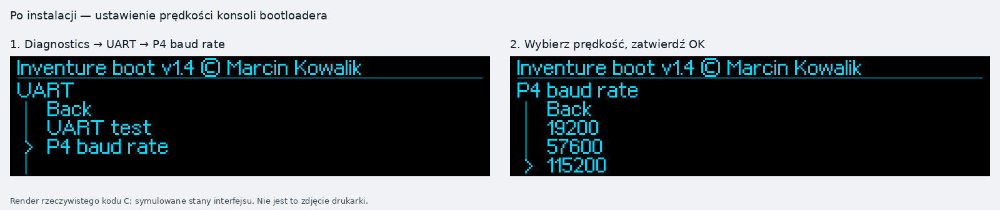

# Inventure boot v1.4 — Zortrax Inventure V9

**Independent service bootloader · Build P4-PERSIST-r2 · SD installer r9898**  
**Autor / Author:** Marcin Kowalik · mkowalik@agh.edu.pl  
**Platforma / Target:** sprawdzona płyta Inventure V9, STM32F207, 256 KiB Flash.

## Pobierz v1.4 / Download

| Co jest obecnie w drukarce? / Current installation | Pakiet / Package |
|---|---|
| Własny Inventure boot v1.2 / v1.3 / wcześniejsza v1.4, rozpoznany przez instalator | **[SD_UPGRADE — aktualizacja / upgrade](firmware/v1.4/Inventure_boot_v1.4_P4_PERSIST_r2_SD_UPGRADE.zip)** |
| Oryginalny bootloader Zortrax na zgodnej V9; spełnione warunki zapisu RDP0 i niezabezpieczonych sektorów BOOT 0–1 oraz APP 4–5 | **[SD_FACTORY_V9 — instalacja fabryczna / factory route](firmware/v1.4/Inventure_boot_v1.4_P4_PERSIST_r2_SD_FACTORY_V9.zip)** |
| ST-Link / SWD z dostępnym odczytem i zapisem Flash | **[BIN 32 KiB — adres 0x08000000](firmware/v1.4/Inventure_boot_v1.4_P4_PERSIST_r2_FULL_32KiB_0x08000000.bin)** |

**[Pełna instrukcja krok po kroku z ekranami — polski](docs/INSTALACJA_PL.md)**  
**[Complete illustrated installation manual — English](docs/INSTALLATION_EN.md)**

**[Konsola P4 — komendy i przykłady aktualizacji ZRTX, odszyfrowanej APP i Klippera](docs/KONSOLA_P4_PRZYKLADY_PL.md)**  
**[P4 UART console and firmware examples — English](docs/P4_UART_EXAMPLES_EN.md)**

**Publiczne skrypty PC / Public PC-side tools:** [`tools/ibtool.py`](tools/ibtool.py) — tworzenie, kontrola i ramkowe przesyłanie IVB przez P4; [`tools/vendor_tool.py`](tools/vendor_tool.py) — bezkluczowa kontrola/pakowanie **już odszyfrowanych** rozpoznanych aplikacji. **Nie ma kluczy AES/HMAC, funkcji odtwarzania tail20 ani odszyfrowywania ZRTX.** Zaszyfrowane oryginalne aktualizacje wgrywa się przez SD.

[Funkcje i konsola](docs/FUNKCJE_I_KONSOLA_PL.md) · [Features and console](docs/FEATURES_AND_CONSOLE_EN.md) · [SHA-256](firmware/v1.4/SHA256SUMS.txt) · [Manifest i status prób / Manifest and test status](docs/RELEASE_MANIFEST.md)

W każdym ZIP na SD są **cztery pliki binarne**. Rozpakuj ZIP na komputerze i skopiuj pliki do katalogu głównego karty FAT32. Wgranie przez SD obejmuje tymczasową aplikację instalatora, dwie sprawdzone kopie bieżącego BOOT, osobne potwierdzenie wymiany BOOT i przywrócenie aplikacji przez **RESTORE.BIN**. Sam surowy BIN 32 KiB służy do ST-Linka.

Each SD ZIP contains **four binary files**. Extract on the computer and copy the files to FAT32 SD root. The SD route installs a temporary service application, verifies two current-BOOT backups, separately confirms BOOT replacement, and then restores the application from **RESTORE.BIN**. The standalone 32-KiB BIN is for ST-Link.

## Potwierdzone działanie / Hardware feedback

**25.10.2026:** właściciel projektu potwierdził po wgraniu tej kompilacji v1.4: „wgrałem do drukarki i przetestowałem opcje działa bez problemu”. Publikowane trzy pakiety zawierają ten sam sprawdzony obraz BOOT. Nie zmieniono binariów po tej próbie.

**25 October 2026:** the owner reported installing this v1.4 build and testing its options without problems. All three packages contain that same BOOT image; the binaries were not changed after that report.

Wcześniej potwierdzono na drukarkach obie drogi instalacji **v1.3**: upgrade v1.2 → v1.3 oraz fabryczny bootloader → v1.3, z przywróceniem oryginalnej aplikacji. Aktualne potwierdzenie r2 nie określa osobno testów wszystkich trzech metod programowania. Zakres prób i ograniczenia opisuje manifest.

Offline: **2395/2395** bootloader tests, **99/99** ARM checks, **157/157** installer tests and **1604/1604** compatibility assertions. Clean-source rebuilds reproduce all compared images byte for byte.

## Zmiany v1.4 / What is new

- **Diagnostics → UART** tuż za Display test; w środku **UART test** i **P4 baud rate**.
- **Trwała prędkość P4:** 19200, 57600, 115200, 250000 lub 500000, odtwarzana po resecie i wyłączeniu zasilania.
- **UP + DOWN podczas startu:** awaryjne 250000 bez nadpisania zapisanego wyboru.
- Oryginalna proporcjonalna czcionka bitmapowa r0323; **Back w lewo**, pozostałe wskaźniki w prawo, Back widoczny przy przewijaniu.
- **5-sekundowy autostart**, oryginalny pierścień postępu i czytelny wynik operacji przez 3 s.
- Zachowane aktualizacje aplikacji SD/UART, sprawdzanie i pomijanie identycznego firmware, przeglądarka plików, kopie, diagnostyka i historia.

*Ekrany w instrukcji są renderami rzeczywistego kodu interfejsu; nie są fotografiami drukarki. / Manual illustrations are renders of the actual UI code, not photographs.*

## Po wgraniu / After installation

**Każda instalacja tego BOOT odnawia dziennik P4 i zaczyna od 250000, 8N1.** Ustaw ponownie swoją prędkość w **Diagnostics → UART → P4 baud rate**. Zwykłe późniejsze aktualizacje aplikacji zachowują ten zapis. Instalator r9898 ma własne stałe 250000, 8N1.

Every installation of this BOOT image resets its P4 journal to **250000, 8N1**. Select your preferred rate again after installation. Later ordinary application updates preserve it. The r9898 installer itself uses 250000, 8N1.

## Warunki instalacji / Installation conditions

Pakiet factory oznacza ścieżkę wejścia przez **rozpoznany fabryczny BOOT V9**. Nie jest narzędziem wyłączania ochrony. Instalator przed zapisem wymaga **RDP0** i prawa zapisu sektorów BOOT 0–1; cały przebieg SD wymaga również zapisywalnych sektorów APP 4–5. Warunki trzeba potwierdzić przed uruchomieniem instalatora; przy odmowie zakończ procedurę. Nie używaj **Mass Erase**, `-rdu` ani zmiany Option Bytes jako sposobu obejścia błędu. Zmiana RDP1 → RDP0 może skasować główną Flash wraz z NVM. Podczas wymiany BOOT zasilanie musi być stabilne; przerwanie może wymagać odzyskania przez SWD.

The factory package uses a recognized factory V9 bootloader; it does not unlock read or write protection. The installer requires **RDP0** and writable BOOT sectors 0–1; the complete SD route also needs writable APP sectors 4–5. Verify these conditions before starting. Do not bypass a rejection with mass erase, `-rdu` or option-byte changes. Follow the conditions and readback procedure in the manual.

## Zakres publikacji / Publication scope

Wydanie v1.4 publikuje **trzy dystrybucje binarne firmware**, **dwa publiczne narzędzia hosta w Pythonie** (bez kluczy kryptograficznych), instrukcje, sumy kontrolne i ilustracje. Bez kodu źródłowego, ELF, map, pełnych zrzutów prywatnej drukarki, NVM, OTP i UID. `RESTORE.BIN` w obu ZIP przywraca konkretną oryginalną aplikację **Zortrax 1.6.1/r0323**; nie jest kopią dowolnej poprzedniej aplikacji. Firmware producenta podlega odrębnym prawom.

The v1.4 publication contains only the three binary distributions, documentation, checksums and illustrations. Manufacturer firmware in RESTORE.BIN retains its separate rights. Historical v1.3 packages remain in [SD_INSTALLATION](SD_INSTALLATION/README.md).

Independent project; not affiliated with or endorsed by Zortrax.
