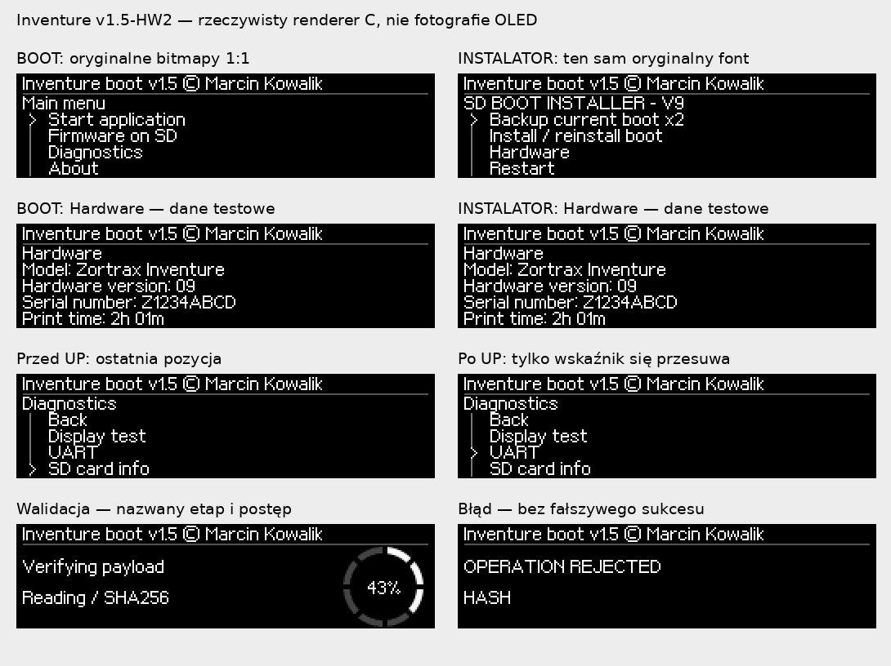

# Inventure boot v1.5 — RELEASE 1.5-HW2

**Zortrax Inventure V9 · STM32F207 · 256 KiB Flash**  
Autor / Author: **Marcin Kowalik**, mkowalik@agh.edu.pl  
Aktualne wydanie / Current release: **v1.5**, kompilacja / build **RELEASE 1.5-HW2**, 29.10.2026.

## Pobierz / Download

| Stan drukarki / Current state | Właściwy plik / Correct file |
|---|---|
| Rozpoznany własny Inventure boot, także v1.4 / Recognized custom bootloader including v1.4 | **[SD UPGRADE — aktualizacja](firmware/v1.5/Inventure_boot_v1.5_HW2_STOCK_FONT_2026-10-29_SD_UPGRADE.zip)** |
| Zgodny fabryczny BOOT V9, spełnione warunki zapisu / Compatible original BOOT V9 with write prerequisites met | **[FROM FACTORY — SD_FACTORY_V9](firmware/v1.5/Inventure_boot_v1.5_HW2_STOCK_FONT_2026-10-29_SD_FACTORY_V9.zip)** |
| Dostęp SWD / ST-Link | **[ST-LINK — 32 KiB, 0x08000000](firmware/v1.5/Inventure_boot_v1.5_HW2_STOCK_FONT_2026-10-29_STLINK_32KiB_0x08000000.bin)** |

[SHA-256 v1.5](firmware/v1.5/SHA256SUMS.txt) · [Manifest i status testów](docs/v1.5/RELEASE_MANIFEST.md)

**[Pełna instrukcja po polsku — trzy metody i ekrany](docs/v1.5/INSTALACJA_PL.md)**  
**[Complete English installation manual — all three routes](docs/v1.5/INSTALLATION_EN.md)**  
[Funkcje i konsola P4 / Features and P4](docs/v1.5/FUNKCJE_I_KONSOLA.md) · [Przykłady aktualizacji APP / APP examples](docs/v1.5/P4_EXAMPLES.md)

## Potwierdzenie na drukarce / Hardware feedback

**29.10.2026:** właściciel zgłosił po wgraniu tej paczki: „wgrałem na 1 drukarkę jest wszystko ok”. Publikacja zachowuje **dokładnie te same binaria**. Jest to potwierdzenie działania na **jednej drukarce**, nie osobny test wszystkich trzech metod, wszystkich prędkości ani awarii zasilania.

The owner reported successful installation and operation on **one printer**. The tested binaries are published unchanged; this report does not certify every installation route or failure mode.

Instalator nadal wypisuje historyczny banner `V1.5 HW2 - HW UNTESTED`, zapisany przed tą próbą. Nie przekompilowano go tylko w celu zmiany napisu. Aktualny status opisuje manifest; identyfikuj pakiet pełną sumą SHA-256, nie samym `r9898`.

**Hardware — potwierdzone na urządzeniu:** 29.10.2026 właściciel dodatkowo potwierdził, że ekran Hardware w stałym bootloaderze **poprawnie odczytuje rzeczywiste dane jego drukarki**. Nie jest to jedynie wynik testu modelowego. Ilustracje w instrukcji nadal zawierają jawnie syntetyczne dane przykładowe; nie są zrzutem prywatnych danych użytkownika.

**Hardware — physically confirmed:** on 29 October 2026 the owner explicitly confirmed that the permanent bootloader Hardware screen **correctly reads the actual printer data** on his device. This is an on-device confirmation, not just a model test. Manual previews still use clearly synthetic examples rather than private printer data.

## Co zmienia v1.5-HW2 / Changes

- **Oryginalna czcionka Inventure r0323, bez skalowania**, wspólna dla BOOT i instalatora. / Original unscaled stock font in both programs.
- **Hardware** w `Diagnostics` bootloadera i menu instalatora: model, wersja sprzętowa i numer z OTP, **Print time** z NVM; `Unavailable` przy braku wiarygodnych danych. / Real read-only device information.
- **Menu bez zawijania**, zapamiętane okno listy, przypięty `Back`, brak mylenia `Backup` z `Back`. / Non-wrapping, stateful list navigation.
- Przesyłanie zmienionego prostokąta OLED zamiast powtarzania pełnej klatki. / Partial display transfers after the first full frame.
- Bezstratna kompresja tekstów: wszystkie funkcje pozostają; **80 B zapasu** przed dziennikiem P4. / Lossless text storage optimization without removing features.

*Rendery rzeczywistego kodu C, nie fotografie. Dane Hardware na planszach są syntetyczne. / Native C renders, not photographs; shown device data are synthetic.*

## Ważne przed instalacją / Important

Oba ZIP-y SD mają po **cztery pliki**, do rozpakowania do głównego katalogu FAT32. Procedura SD tymczasowo zastępuje aplikację pośrednikiem, wykonuje dwie kopie BOOT i podmienia BOOT dopiero po osobnym potwierdzeniu. **Następnie przywróć APP przez `RESTORE.BIN`**: Zortrax Inventure **1.6.1/r0323**, nie kopię dowolnej poprzedniej aplikacji.

Both SD routes require restoring the APP afterwards. ST-Link programs **only sectors 0–1**, leaving APP/NVM intact. Never use Mass Erase, Read Unprotect or option-byte changes to bypass an installation refusal. Factory route requires the exact recognized V9 BOOT, RDP0 and writable BOOT/APP sectors; it does not remove protection.

Wymiana BOOT odnawia dziennik P4: pierwszy start **250000, 8N1**. Ustaw ponownie prędkość w `Diagnostics → UART → P4 baud rate`. Zwykłe aktualizacje APP jej nie kasują. Instalator używa własnego stałego 250000.

## v1.4 pozostaje dostępna / v1.4 retained

**[Archiwalne trzy pliki v1.4](firmware/v1.4/)** · [sumy v1.4](firmware/v1.4/SHA256SUMS.txt) · [instrukcja PL v1.4](docs/INSTALACJA_PL.md) · [English v1.4](docs/INSTALLATION_EN.md) · [manifest v1.4](docs/RELEASE_MANIFEST.md).

Binaria, sumy i dotychczasowa dokumentacja v1.4 są zachowane. Udostępnienie starego ZIP-a **nie oznacza**, że jego instalator rozpoznaje BOOT v1.5-HW2 i pozwoli na downgrade; nie obchodź odmowy nieznanego obrazu. Zachowane są także wcześniejsze paczki v1.3 w `SD_INSTALLATION`.

## Publiczne narzędzia / Public tools

[`tools/ibtool.py`](tools/ibtool.py): IVB pack/inspect/serial. [`tools/vendor_tool.py`](tools/vendor_tool.py): kontrola i pakowanie **już odszyfrowanych** znanych aplikacji. Skrypty pozostają bez zmian i bez sekretów AES/HMAC/tail20. Nie odszyfrowują ZRTX; zaszyfrowany oryginał instaluj przez SD.

Nie publikujemy prywatnego archiwum KOMPLET, źródeł bootloadera/instalatora, plików ELF/map, samodzielnych plików czcionek ani zrzutów urządzenia. Publiczne firmware producenta zachowuje odrębne prawa. / Private sources and unique printer data are not part of this release.
