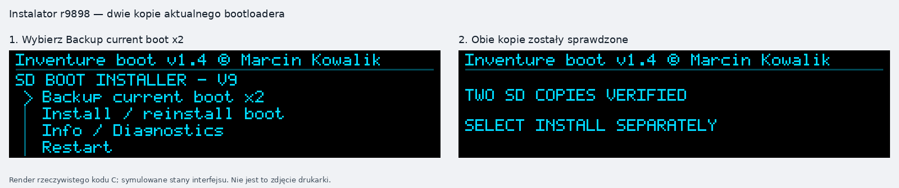
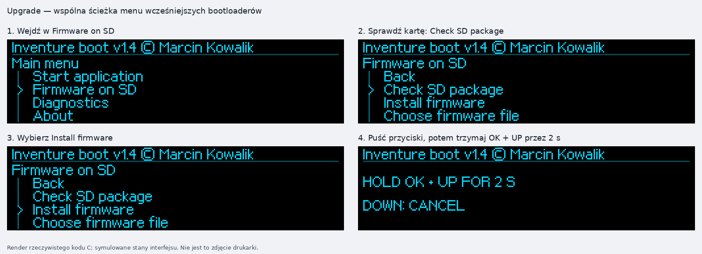
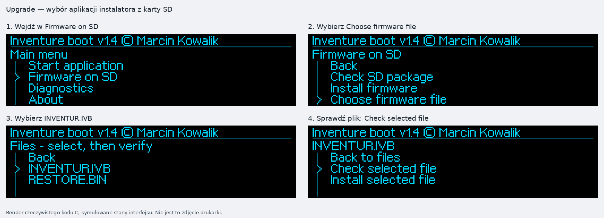
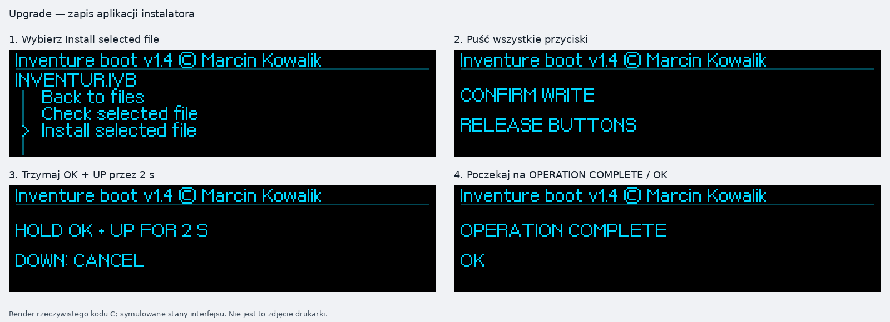
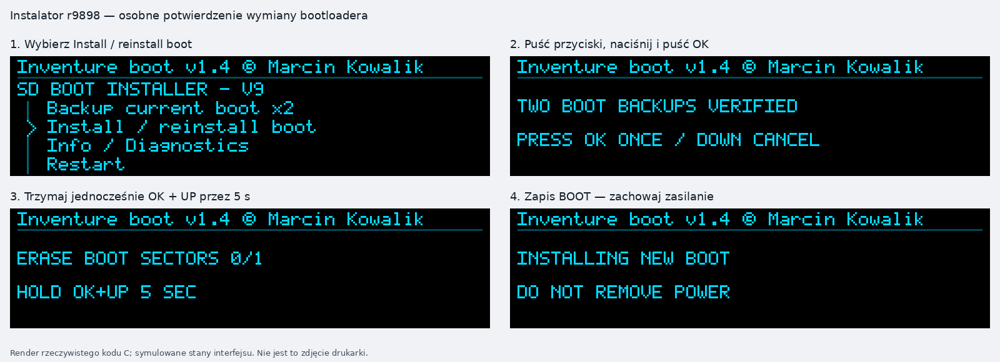
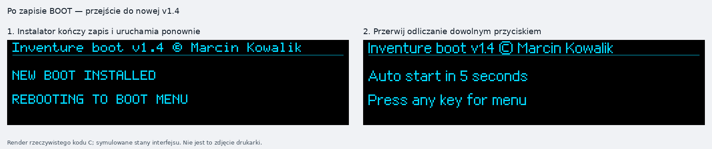
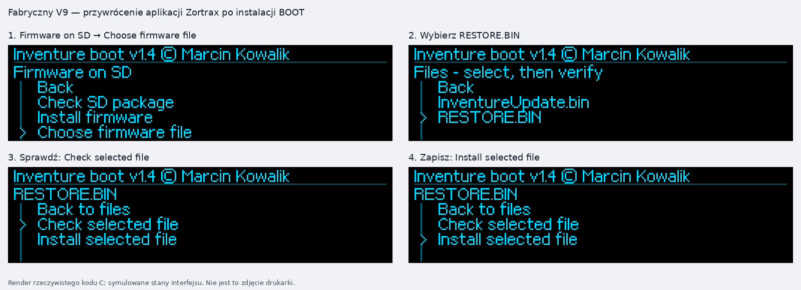
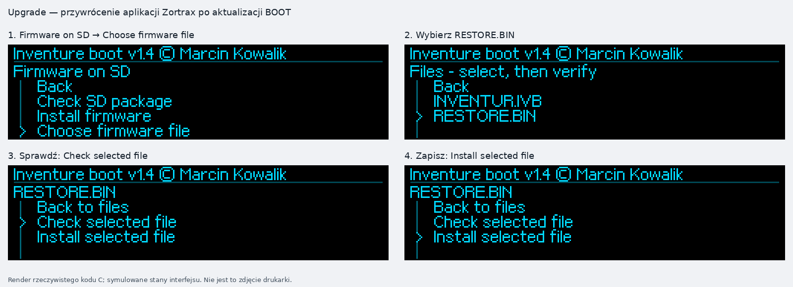
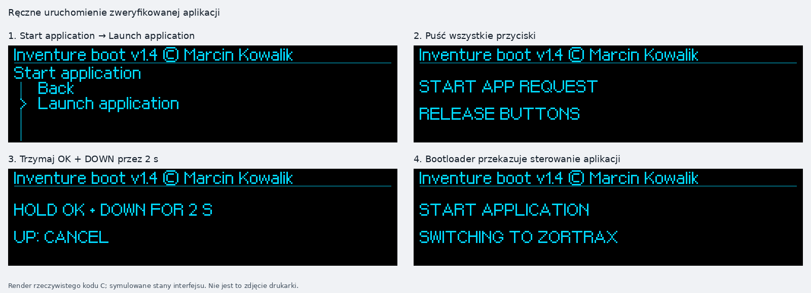

# Inventure boot v1.4 — pełna instrukcja instalacji

**Wydanie:** P4-PERSIST-r2 · **Instalator SD:** r9898 · **Data:** 25.10.2026  
**Autor:** Marcin Kowalik · mkowalik@agh.edu.pl  
**Platforma:** zgodna płyta Zortrax Inventure V9, STM32F207, 256 KiB Flash.

[Strona projektu](../README.md) · [English manual](INSTALLATION_EN.md) · [Funkcje i konsola](FUNKCJE_I_KONSOLA_PL.md) · [Manifest i sumy](RELEASE_MANIFEST.md)

Właściciel potwierdził wgranie końcowej v1.4 r2 i działanie opcji na drukarce. Poniższe pakiety zawierają niezmieniony obraz z tej próby. Wcześniejsze potwierdzenia dwóch dróg SD dotyczą v1.3; aktualne zgłoszenie r2 nie wyszczególnia osobnych prób wszystkich trzech metod. Dokładny zakres walidacji jest w [manifeście](RELEASE_MANIFEST.md).

## Spis treści

1. [Wybór pliku i warunki przed rozpoczęciem](#przed-startem)
2. [Przygotowanie karty SD](#karta)
3. [A. Drukarka z oryginalnym bootloaderem Zortrax](#factory)
4. [B. Upgrade istniejącego Inventure boot](#upgrade)
5. [C. Wspólny etap obu dróg SD: kopie, BOOT, przywrócenie aplikacji](#instalator)
6. [D. Programowanie przez ST-Link](#stlink)
7. [Ustawienie i zapamiętywanie prędkości P4](#p4)
8. [Rozwiązywanie problemów](#problemy)

<a id="przed-startem"></a>

## 1. Wybór pliku i warunki przed rozpoczęciem

| Obecny stan drukarki | Pobierz | Dalsze kroki |
|---|---|---|
| Rozpoznany oryginalny BOOT Zortraxa na V9, z dostępnym zapisem | [Inventure_boot_v1.4_P4_PERSIST_r2_SD_FACTORY_V9.zip](../firmware/v1.4/Inventure_boot_v1.4_P4_PERSIST_r2_SD_FACTORY_V9.zip) | Przygotowanie karty → A → C |
| Rozpoznany własny Inventure boot v1.2, v1.3 lub wcześniejsza v1.4 | [Inventure_boot_v1.4_P4_PERSIST_r2_SD_UPGRADE.zip](../firmware/v1.4/Inventure_boot_v1.4_P4_PERSIST_r2_SD_UPGRADE.zip) | Przygotowanie karty → B → C |
| Bezpośredni dostęp SWD przez ST-Link, możliwy pełny odczyt i zapis BOOT | [Inventure_boot_v1.4_P4_PERSIST_r2_FULL_32KiB_0x08000000.bin](../firmware/v1.4/Inventure_boot_v1.4_P4_PERSIST_r2_FULL_32KiB_0x08000000.bin) | D |

**Przed włożeniem karty instalacyjnej** potwierdź zgodność płyty i stan ochron pamięci. Obie drogi SD wymagają **RDP Level 0**, braku ochrony zapisu sektorów **0 i 1** (BOOT) oraz możliwości zapisu sektorów **4 i 5** (aplikacja). W STM32F2 RDP0 ma wartość `0xAA`, a nWRP równy 1 oznacza brak ochrony zapisu danego sektora. Stan można odczytać bez jego zmieniania przez ST-Link — patrz początek [sekcji D](#stlink). Jeżeli stan nie jest znany, ustal go przed rozpoczęciem SD; sama nazwa płyty V9 lub działająca aktualizacja producenta nie potwierdza tych warunków.

**SD_FACTORY_V9 jest ścieżką instalacji przez zgodny fabryczny bootloader.** Instalator nie wyłącza RDP ani ochron sektorów i nie zmienia Option Bytes. Pierwszy etap zastępuje aplikację drukarki instalatorem **zanim** ten sprawdzi dopuszczenie zapisu BOOT. Dlatego nie rozpoczynaj tej drogi na niezweryfikowanym egzemplarzu w nadziei, że późniejsza odmowa cofnie cały proces. Odmowa nie przywraca automatycznie aplikacji.

Znany fabryczny BOOT ma 32768 bajtów i SHA-256 `19640ae302d918a79a243dbc7a5efcf055f78a1b459af4b50f3e66575af81752`. Własne wcześniejsze wydania również muszą być rozpoznawane przez instalator; sam napis wersji na OLED nie wystarcza. Nie obchodź odmowy dla nieznanego obrazu.

Zachowaj istniejące kopie drukarki i potrzebne dane z karty. Zapewnij stabilne zasilanie na cały zapis. Wymiana BOOT kasuje sektory rozruchowe; przerwanie tego etapu może wymagać naprawy przez SWD. **Nie używaj Mass Erase, Read Unprotect, `-rdu` ani zmiany Option Bytes do obchodzenia odmowy.** Przejście RDP1 → RDP0 kasuje główną Flash, w tym fabryczne NVM; opis ST: [PM0059, ochrona pamięci](https://www.st.com/resource/en/programming_manual/pm0059-stm32f205215-stm32f207217-flash-programming-manual-stmicroelectronics.pdf).

### Co zmienia każda metoda

| Obszar | Adresy | Instalacja SD | ST-Link zgodnie z sekcją D |
|---|---|---|---|
| BOOT, sektory 0–1 | `0x08000000–0x08007FFF` | Wymieniany przez r9898 po dwóch kopiach i osobnym potwierdzeniu | Wymieniany bezpośrednio |
| NVM/kalibracja, sektory 2–3 | `0x08008000–0x0800FFFF` | Zachowywane | Zachowywane i porównywane odczytem |
| APP/metadane, sektory 4–5 | `0x08010000–0x0803FFFF` | Najpierw instalator, potem aplikacja z RESTORE.BIN | Zachowywane i porównywane odczytem |

`RESTORE.BIN` przywraca konkretną oryginalną aplikację **Zortrax Inventure 1.6.1/r0323**. To nie jest kopia dowolnej wcześniej zainstalowanej wersji. Przed drogą SD potwierdź, że ta aplikacja jest właściwa dla drukarki. Firmware producenta podlega odrębnym prawom.

### Sprawdzenie pobranego pliku

Pobierz [SHA256SUMS.txt](../firmware/v1.4/SHA256SUMS.txt) do tego samego katalogu. Wartości są również w [manifeście](RELEASE_MANIFEST.md). Na macOS możesz obliczyć hash przez `shasum -a 256 NAZWA_PLIKU`, na Linux przez `sha256sum NAZWA_PLIKU`, a w PowerShell przez `Get-FileHash -Algorithm SHA256 NAZWA_PLIKU`. Porównaj pełne 64 znaki dla wybranego ZIP lub BIN. Różny hash oznacza, że nie należy używać tego pliku.

<a id="karta"></a>

## 2. Przygotowanie karty SD

1. Zachowaj potrzebne dane z karty. Przygotuj kartę **FAT32** dostępną do zapisu, bez blokady LOCK. Formatowanie usuwa dotychczasową zawartość, więc wykonuj je dopiero po skopiowaniu potrzebnych plików.
2. Rozpakuj **jeden** wybrany ZIP na komputerze.
3. Skopiuj jego **cztery pliki bezpośrednio do katalogu głównego karty**. Nie kopiuj samego ZIP ani katalogu opakowującego.
4. Sprawdź nazwy według tabeli. Nie zostawiaj innych pakietów aktualizacji, starego `INVENTUR.BIN` ani instalatora z drugiej drogi.
5. Bezpiecznie wysuń kartę w systemie operacyjnym.

| Karta factory | Karta upgrade | Znaczenie |
|---|---|---|
| `InventureUpdate.bin` | `INVENTUR.IVB` | Aplikacja instalatora r9898, w formacie odpowiednim dla obecnego BOOT |
| `RESTORE.BIN` | `RESTORE.BIN` | Aplikacja Zortrax 1.6.1/r0323, 164864 B |
| `ZBACKUP.BIN` | `ZBACKUP.BIN` | Pierwsze przygotowane miejsce na kopię BOOT, 32768 B |
| `ZBACK2.BIN` | `ZBACK2.BIN` | Drugie przygotowane miejsce na kopię BOOT, 32768 B |

Pliki ZBACKUP i ZBACK2 z ZIP są początkowo szablonami wypełnionymi `A5`. **Prawdziwymi kopiami staną się dopiero po operacji Backup current boot x2 i jej poprawnej weryfikacji.** Instalator zapisuje już istniejące pliki; nie zastępuj ich pustymi plikami o tych samych nazwach. Każda kopia obejmuje pełne 32 KiB aktualnego BOOT, w tym jego ewentualne ustawienie P4. Nie obejmuje całej Flash, NVM ani aplikacji.

Przy kolejnej instalacji najpierw zarchiwizuj rzeczywiste wcześniejsze kopie na komputerze, a dopiero potem przygotuj kartę ze świeżych plików paczki. Nie nadpisuj jedynego backupu szablonem z ZIP. Dwa pliki na tej samej karcie nie są dwiema niezależnymi kopiami nośnika.

### Obsługa przycisków i ilustracje

**UP/GÓRA** i **DOWN/DÓŁ** zmieniają wybór; **OK** wchodzi do pozycji. Przed potwierdzeniem operacji trzeba puścić przyciski użyte do nawigacji. Zapis APP wymaga **OK+UP przez 2 s**, ręczne uruchomienie APP — **OK+DOWN przez 2 s**, wymiana BOOT w instalatorze — **osobny OK, potem OK+UP przez 5 s**.

W v1.4 ekran wyniku znika sam po **3 s**; w instalatorze r9898 po około **1,8 s**. Nie zamykaj go ciągłym trzymaniem OK. Puść przyciski, poczekaj na menu i dopiero wtedy wykonaj kolejny wybór.

Ilustracje poniżej są powiększonymi renderami rzeczywistego kodu interfejsu. Nie są fotografiami ani nowymi próbami sprzętowymi. Instalator r9898 zachowuje swoją starszą czcionkę 5×7; nowy BOOT ma oryginalną czcionkę proporcjonalną. Ekrany startu upgrade pokazują wygląd r2: starszy BOOT może mieć inny font, pozycję Back i czas odliczania. Kolejność plików zależy od karty — wybieraj po nazwie. Numeracja na ilustracji dotyczy tylko jej paneli.

<a id="factory"></a>

## A. Oryginalny bootloader Zortrax → v1.4 przez SD

Ta droga zaczyna się w oryginalnym BOOT i kończy działającą aplikacją Zortrax pod nowym BOOT. Użyj **SD_FACTORY_V9** po sprawdzeniu [warunków przed rozpoczęciem](#przed-startem).

1. Przygotuj kartę factory według sekcji 2: `InventureUpdate.bin`, `RESTORE.BIN`, `ZBACKUP.BIN`, `ZBACK2.BIN`.
2. **Wyłącz drukarkę**, włóż kartę i włącz zasilanie. Nie trzeba przytrzymywać dodatkowego skrótu przycisków.
3. Oryginalny bootloader automatycznie wykryje `InventureUpdate.bin` i zapisze aplikację serwisową r9898. W tej chwili nie są jeszcze wymieniane sektory BOOT. Poczekaj, nie wyłączając zasilania i nie wyjmując karty.
4. Po ukończeniu fabrycznej aktualizacji aplikacja instalatora uruchomi się **automatycznie**. Nie jest potrzebny drugi ręczny reset. Zobaczysz ekran `INVENTURE SD BOOT INSTALLER r9898`, następnie menu `SD BOOT INSTALLER - V9`.
5. Przejdź kolejno przez **wszystkie kroki [C1–C7](#instalator)**: dwie kopie BOOT, osobne potwierdzenie instalacji, zatrzymanie odliczania po restarcie, jawny wybór `RESTORE.BIN`, zapis aplikacji, Verify Flash i końcowy start.

Pierwszy ekran, od którego zaczyna się wspólna obsługa obu dróg SD:



**Nie kończ procedury na komunikacie NEW BOOT INSTALLED.** W pamięci aplikacji nadal znajduje się wtedy instalator. Dopiero kroki C4–C7 przywracają normalny program drukarki.

<a id="upgrade"></a>

## B. Upgrade Inventure boot v1.2 / v1.3 / wcześniejszej v1.4

Użyj **SD_UPGRADE**. Poniższy początek korzysta z opcji dostępnych także w v1.2, która nie ma przeglądarki wyboru plików.

1. Przygotuj kartę upgrade: `INVENTUR.IVB`, `RESTORE.BIN`, `ZBACKUP.BIN`, `ZBACK2.BIN`. Uruchom drukarkę z tą kartą. Jeżeli obecny BOOT odlicza do startu aplikacji, przerwij odliczanie dowolnym przyciskiem i puść go.
2. Wybierz **Firmware on SD → Check SD package**. Przy świeżym starcie i prawidłowej karcie automatyczny wybór wskazuje `INVENTUR.IVB`. Poczekaj na poprawny wynik i powrót do menu. `RESTORE.BIN` nie bierze udziału w tym automatycznym wyborze.
3. Wybierz **Install firmware**. Puść przyciski i po wyświetleniu prośby przytrzymaj jednocześnie **OK+UP przez 2 s**. DOWN anuluje. Zaczekaj na zakończenie zapisu i poprawny wynik.
4. Wróć przez **Back** do menu głównego. W v1.2 wybierz **Start firmware → Launch application**; w v1.3/v1.4 — **Start application → Launch application**. Puść przyciski, potem przytrzymaj **OK+DOWN przez 2 s**. UP anuluje.
5. Uruchomi się aplikacja r9898 z menu **SD BOOT INSTALLER - V9**. Dotychczasowy BOOT jest jeszcze na miejscu: kroki 2–3 zapisały tylko aplikację instalatora.
6. Wykonaj kolejno **wszystkie kroki [C1–C7](#instalator)**, aż do przywrócenia i uruchomienia aplikacji Zortrax.



Starszy BOOT może pokazywać **Back na końcu** podmenu. Nowa v1.4 ma go u góry. Nie kieruj się numerem pozycji; kieruj się napisem. Wcześniejsze odliczanie może być krótsze niż 5 s.

### Wariant dla v1.3/v1.4 z przeglądarką plików

Zamiast kroków B2–B3 możesz wybrać **Firmware on SD → Choose firmware file → INVENTUR.IVB**. Na stronie z tytułem `INVENTUR.IVB` uruchom najpierw **Check selected file**, poczekaj na sukces i powrót, a potem **Install selected file**. Potwierdzenie pozostaje takie samo: puścić przyciski, następnie OK+UP przez 2 s. Kontynuuj od kroku B4.





<a id="instalator"></a>

## C. Wspólny etap obu dróg SD

W tym miejscu na drukarce działa **r9898**. Pozostaw w niej tę samą kartę, z której rozpoczęto instalację. Terminal UART nie jest potrzebny do wykonania tych kroków. Jeśli go używasz, instalator pracuje zawsze z **250000 baud, 8N1**, niezależnie od wcześniejszego ustawienia BOOT.

### C1. Zapisz i sprawdź dwie kopie aktualnego BOOT

Wybierz **Backup current boot x2**. Podczas kopiowania pojawi się `BACKUP CURRENT BOOT x2` / `KEEP POWER ON`. Zaczekaj na zapis i odczytową weryfikację obu plików.

Prawidłowy wynik nowych kopii to **TWO SD COPIES VERIFIED / SELECT INSTALL SEPARATELY**. Jeśli obie kopie były już poprawne, komunikat może brzmieć **TWO BOOT BACKUPS VERIFIED / READY FOR BOOT INSTALL**. Po około 1,8 s wróci menu. Samo utworzenie kopii nie rozpoczyna wymiany BOOT.


Przy błędzie kopii nie przechodź do instalacji. Zobacz [rozwiązywanie problemów](#problemy).

### C2. Osobno zatwierdź wymianę BOOT

1. Wybierz **Install / reinstall boot** i puść OK użyte do wyboru.
2. Na ekranie **TWO BOOT BACKUPS VERIFIED / PRESS OK ONCE / DOWN CANCEL** naciśnij i puść **sam OK**. DOWN anuluje.
3. Dopiero na ekranie **ERASE BOOT SECTORS 0/1 / HOLD OK+UP 5 SEC** przytrzymaj jednocześnie **OK+UP przez pełne 5 s**. Przerwanie trzymania nie zatwierdza operacji częściowo.
4. Poczekaj podczas **INSTALLING NEW BOOT / DO NOT REMOVE POWER**. W tym etapie zapisywane są sektory 0 i 1. Nie wyłączaj zasilania i nie wyjmuj karty.



Instalator przed zapisem ponownie sprawdza kopie, zgodność bieżącego BOOT, RESTORE i warunki sprzętowe. Jeśli zgłosi odmowę, nie próbuj obchodzić kontroli. Sposób rozpoznania problemu opisano na końcu instrukcji.

### C3. Po restarcie zatrzymaj odliczanie nowej v1.4

Po sukcesie zobaczysz **NEW BOOT INSTALLED / REBOOTING TO BOOT MENU**. Po około 1 s nastąpi reset. Na ekranie v1.4 **naciśnij dowolny przycisk podczas pięciosekundowego odliczania**, a następnie puść go, aby wejść do menu.



Jeśli przegapisz odliczanie, uruchomi się ponownie aplikacja instalatora. Wybierz w niej **Restart** i przy kolejnym starcie zatrzymaj odliczanie. Nie powtarzaj `Install / reinstall boot` tylko dlatego, że ponownie widać instalator.

### C4. Wybierz i sprawdź RESTORE.BIN

W nowym menu wybierz **Firmware on SD → Choose firmware file → RESTORE.BIN**. Upewnij się, że tytuł otwartej strony to **RESTORE.BIN**, a następnie wybierz **Check selected file**. Sukces to **OPERATION COMPLETE / OK**. Puść przyciski i poczekaj 3 s na powrót.

**Karta z drogi factory** będzie zawierać `InventureUpdate.bin` obok pliku RESTORE:



**Karta z drogi upgrade** będzie zawierać `INVENTUR.IVB` obok pliku RESTORE:



Kolejność pozycji na rzeczywistej karcie może być inna. **RESTORE nie jest wybierany automatycznie** przez ogólne `Check SD package` po nowym starcie. Wybierz go jawnie po nazwie i wykonuj operacje ze strony `RESTORE.BIN`.

### C5. Zapisz aplikację Zortrax

Na stronie `RESTORE.BIN` wybierz **Install selected file**. Gdy zobaczysz **CONFIRM WRITE / RELEASE BUTTONS**, puść wszystkie przyciski. Następnie, na ekranie **HOLD OK + UP FOR 2 S / DOWN: CANCEL**, trzymaj **OK+UP przez 2 s**.

Czekaj przez kasowanie, zapis i weryfikację APP, nie przerywając zasilania i nie wyjmując karty. Poprawne zakończenie to **OPERATION COMPLETE / OK**. Poczekaj na automatyczny powrót po 3 s. Sam zapis nie uruchamia jeszcze aplikacji. Jeśli właściwy obraz był już identyczny, komunikat **ALREADY INSTALLED / FLASH WRITE SKIPPED** oznacza pominięcie zbędnego zapisu.

### C6. Zweryfikuj Flash po przywróceniu aplikacji

Wróć pozycjami **Back to files → Back → Back** do menu głównego. Wybierz **Diagnostics → Verify Flash**. Po wyniku **OPERATION COMPLETE / OK** zaczekaj 3 s, następnie wróć przez Back.

Ta kontrola czyta aplikację z pamięci drukarki. Nie zastępuje jej wcześniejsze sprawdzenie pliku na karcie. Przy błędzie nie uruchamiaj niesprawdzonej aplikacji; zachowaj komunikat i sprawdź pliki/zapis.

### C7. Zakończ i uruchom zwykłą aplikację

Po udanej weryfikacji i powrocie do menu **wyłącz drukarkę**, wyjmij kartę instalacyjną i zachowaj zapisane **ZBACKUP.BIN oraz ZBACK2.BIN na komputerze**, w katalogu opisanym datą i egzemplarzem drukarki. Nie zastępuj ich szablonami z pobranego ZIP.

Włącz drukarkę bez karty instalacyjnej. Po 5 s powinno uruchomić się zwykłe menu aplikacji Zortrax. Możesz też zatrzymać odliczanie i uruchomić ją ręcznie przez **Start application → Launch application**: puść przyciski, następnie przytrzymaj **OK+DOWN przez 2 s**. UP anuluje.



Procedura SD jest zakończona, kiedy działa **v1.4 P4-PERSIST-r2**, `Verify Flash` kończy się poprawnie i uruchamia się właściwa aplikacja drukarki. Jeśli używasz konsoli P4, ustaw ponownie swoją prędkość według [sekcji P4](#p4).

<a id="stlink"></a>

## D. Instalacja przez ST-Link / SWD

Ta ścieżka zapisuje bezpośrednio **32 KiB bootloadera**. Nie uruchamia instalatora SD i nie zastępuje znajdującej się w drukarce aplikacji. Użyj pliku:

`Inventure_boot_v1.4_P4_PERSIST_r2_FULL_32KiB_0x08000000.bin`

| Parametr | Wartość |
|---|---|
| Rozmiar pliku | 32768 bajtów / 0x8000 |
| Adres zapisu | **0x08000000** |
| Zmieniany obszar | **0x08000000–0x08007FFF**, sektory **0 i 1** |
| Zachowywane NVM | 0x08008000–0x0800FFFF, sektory 2 i 3 |
| Zachowywana aplikacja i metadane | 0x08010000–0x0803FFFF |
| SHA-256 pliku BOOT | `9ffd140879b6946bed63928fba3ff7b38ff3db289710a2e0845eecbd9caf10ea` |

### 1. Połączenie

Zainstaluj [STM32CubeProgrammer](https://www.st.com/en/development-tools/stm32cubeprog.html). Przy wyłączonym zasilaniu połącz odpowiadające sobie sygnały **SWCLK, SWDIO, GND i NRST** oraz wejście odniesienia napięcia **VTref/T_VCC** programatora z napięciem logicznym płytki. VTref jest odniesieniem poziomu sygnałów; nie traktuj go jako polecenia zasilania całej drukarki z programatora. Korzystaj ze zwykłego zasilania drukarki. Numery wyprowadzeń zależą od użytego adaptera ST-Link. Po stronie płyty korzystaj ze sprawdzonego oznaczenia lub pomiaru sygnałów dla swojego egzemplarza; ta instrukcja nie przypisuje niepotwierdzonej orientacji złącza. Nie podłączaj przewodów na podstawie samego podobieństwa położenia pinów.

W CubeProgrammer wybierz ST-LINK i **SWD**. Tryb **Connect under reset** z **Hardware reset** zatrzymuje rdzeń na początku startu; wymaga podłączonego NRST. Ustaw początkowo 1000 kHz lub niższą dostępną częstotliwość i połącz się. Potwierdź zgodny STM32F207 oraz 256 KiB Flash. Podczas całej operacji zachowaj zatrzymany rdzeń; nie uruchamiaj aplikacji przed końcowym odczytem kontrolnym. [Dokumentacja połączenia ST-Link](https://dev.st.com/stm32cube-docs/prog/2.23.0/en/docs/markup/STLink_Connection_page.html).

### 2. Sprawdzenie dostępu — bez zmiany ochron

Odczytaj **Option bytes**, ale niczego w nich nie zapisuj. Kontynuuj tylko przy **RDP Level 0** oraz wyłączonej ochronie zapisu sektorów 0 i 1. Dla STM32F2 surowy RDP0 to 0xAA, a bit nWRP równy 1 oznacza brak ochrony danego sektora; interfejs może prezentować te stany opisowo.

Jeżeli odczyt jest zablokowany, aktywne jest RDP1/RDP2 albo ochrona potrzebnych sektorów, **przerwij tę procedurę**. Nie używaj „Read Unprotect”, `-rdu`, zmiany RDP, `-ob ...=...` ani pełnego kasowania. Przejście RDP1→RDP0 kasuje główną Flash i backup SRAM, a wraz z Flash utraciłoby także fabryczne NVM. Udany zrzut wykonany przez działające firmware nie dowodzi, że odczyt przez SWD jest odblokowany. [ST PM0059, rozdziały 2.6.3–2.6.4](https://www.st.com/resource/en/programming_manual/pm0059-stm32f205215-stm32f207217-flash-programming-manual-stmicroelectronics.pdf).

### 3. Kopia aktualnej pamięci

W **Memory & file edition / Device memory** ustaw adres **0x08000000** i długość **0x40000** (262144 bajty), wykonaj **Read**, następnie **Save As…** do pliku **BEFORE.bin** w nowym katalogu na komputerze. Sprawdź rozmiar zapisanego pliku. Zachowaj także odczytane wartości Option bytes, np. jako lokalny zrzut ekranu. Nie nadpisuj wcześniejszych kopii.

Nie przechodź do kasowania, jeśli pełny odczyt kończy się błędem, plik ma inny rozmiar albo nie ma pewności, że dotyczy bieżącego egzemplarza. To właśnie BEFORE.bin będzie punktem odniesienia dla kontroli NVM i aplikacji. [Odczyt i zapis plików w CubeProgrammer](https://dev.st.com/stm32cube-docs/prog/2.23.0/en/docs/markup/CubeProg_UserManual/Memory_file_edition.html).

Przed kasowaniem sprawdź także rozmiar i SHA-256 pobranego pliku BOOT według tabeli na początku tej sekcji. Nie używaj tu plików `INVENTUR.IVB` ani `InventureUpdate.bin` z pakietu SD.

### 4. Kasowanie wyłącznie BOOT

W **Erasing & programming** zaznacz tylko:

- sektor **0**, start **0x08000000**, rozmiar **16 KiB**;
- sektor **1**, start **0x08004000**, rozmiar **16 KiB**.

Wykonaj **Erase selected sectors** i sprawdź powodzenie. Nie zaznaczaj sektorów 2–5 i nie używaj **Full chip erase**. Nie zwalniaj zatrzymania rdzenia i nie wykonuj samodzielnego restartu drukarki po samym skasowaniu BOOT; kontynuuj programowanie.

### 5. Zapis i weryfikacja

Wskaż pobrany plik BOOT oraz adres **0x08000000**. Ustaw:

- **Verify after programming:** włączone;
- **Skip flash memory erase before programming:** włączone, ponieważ sektory 0 i 1 zostały właśnie poprawnie skasowane;
- **Run after programming:** wyłączone.

Wykonaj **Start programming**. Oczekuj powodzenia zapisu i weryfikacji. Błąd oznacza zatrzymanie procedury, nie zgodę na zwiększenie zakresu kasowania. [Programowanie i kasowanie w CubeProgrammer](https://dev.st.com/stm32cube-docs/prog/2.23.0/en/docs/markup/CubeProg_UserManual/Memory_programming_and_erasing.html).

### 6. Pełny odczyt kontrolny przed uruchomieniem

Bez uruchamiania aplikacji ponownie odczytaj **0x40000 bajtów od 0x08000000** i zapisz jako **AFTER.bin**. W plikach musi zachodzić jednocześnie:

1. pierwsze **32768 bajtów AFTER.bin** są dokładnie równe pobranemu plikowi BOOT;
2. całe pozostałe **229376 bajtów**, od offsetu **0x8000** do końca, jest identyczne w BEFORE.bin i AFTER.bin.

Drugi warunek obejmuje oba banki NVM, aplikację i jej metadane. Nie porównuj tej kontroli do przypadkowej starej kopii, bo aplikacja mogła wcześniej zmienić NVM podczas zwykłego używania.

Poniższy fragment Python 3 wykonuje wyłącznie odczyt trzech plików z bieżącego katalogu. Nie łączy się z drukarką i niczego nie zapisuje:

```python
from pathlib import Path
import hashlib

before = Path("BEFORE.bin").read_bytes()
after = Path("AFTER.bin").read_bytes()
boot = Path("Inventure_boot_v1.4_P4_PERSIST_r2_FULL_32KiB_0x08000000.bin").read_bytes()
expected = "9ffd140879b6946bed63928fba3ff7b38ff3db289710a2e0845eecbd9caf10ea"

checks = {
    "BEFORE: 262144 B": len(before) == 262144,
    "AFTER: 262144 B": len(after) == 262144,
    "BOOT: 32768 B": len(boot) == 32768,
    "SHA-256 BOOT": hashlib.sha256(boot).hexdigest() == expected,
    "BOOT odczytany identycznie": after[:32768] == boot,
    "NVM i aplikacja bez zmian": after[32768:] == before[32768:],
}
for name, ok in checks.items():
    print(("PASS" if ok else "FAIL"), name)
if not all(checks.values()):
    raise SystemExit("STOP: odczyt kontrolny nie jest zgodny.")
print("PASS: bootloader zapisany; NVM i aplikacja zachowane.")
```

Wszystkie pozycje muszą dać PASS. Jeżeli choć jedna daje FAIL, nie uruchamiaj aplikacji i zachowaj oba odczyty do analizy.

### 7. Pierwszy start

Po prawidłowej weryfikacji odłącz sesję programatora, wyłącz zasilanie i odepnij przewody. Włącz drukarkę i przerwij pięciosekundowe odliczanie przyciskiem. Sprawdź v1.4 na OLED, a jeśli używasz konsoli — `BUILD P4-PERSIST-r2` w odpowiedzi na `INFO`. Pierwsza prędkość P4 to **250000, 8N1**; własną wybierzesz w **Diagnostics → UART → P4 baud rate**.

Przy zapisie ST-Link aplikacja jest zachowana, więc nie trzeba instalować RESTORE tylko dlatego, że zmieniono BOOT. Jeżeli w obszarze aplikacji znajdował się już instalator serwisowy lub obraz nieprawidłowy, należy osobno zainstalować właściwą aplikację przez menu bootloadera. Zapis samego BOOT nie naprawia automatycznie zawartości APP.

### Opcjonalnie: odpowiedniki CLI dla macOS/Linux

Przykłady zakładają dostępne w PATH `STM32_Programmer_CLI` i nowy katalog roboczy. Na macOS Intel plik programu znajduje się wewnątrz `STM32CubeProgrammer.app/Contents/MacOs/bin/`; w wydaniu Apple Silicon — `Contents/Resources/bin/`. Zastąp nazwę programu pełną ścieżką, jeśli nie jest w PATH.

Odczyt ochron i pełna kopia — nadal bez zapisu:

```sh
STM32_Programmer_CLI -c port=SWD mode=UR reset=HWrst freq=1000 -ob displ
STM32_Programmer_CLI -c port=SWD mode=UR reset=HWrst freq=1000 -u 0x08000000 0x40000 BEFORE.bin
```

Dopiero po sprawdzeniu RDP/WRP, kopii i hashy wykonaj kolejno kasowanie dwóch sektorów, zapis z pominięciem automatycznego kasowania, weryfikację i odczyt. Nie dodawaj `-rst`, `-g` ani `-s` przed kontrolą AFTER.bin:

```sh
STM32_Programmer_CLI -c port=SWD mode=UR reset=HWrst freq=1000 -e 0 1
STM32_Programmer_CLI -c port=SWD mode=UR reset=HWrst freq=1000 -skiperase -w "Inventure_boot_v1.4_P4_PERSIST_r2_FULL_32KiB_0x08000000.bin" 0x08000000 -v -u 0x08000000 0x40000 AFTER.bin
```

Nie uruchamiaj kolejnej komendy po błędzie poprzedniej. `-v` musi stać bezpośrednio po pliku/adresie operacji `-w`. Używamy listy `-e 0 1`, bez składni zakresu w nawiasach problematycznej w zsh. Składnię zweryfikowano w [oficjalnej dokumentacji CLI 2.23.0](https://dev.st.com/stm32cube-docs/prog/2.23.0/en/docs/markup/CubeProg_Command_Lines.html); nie jest to deklaracja wykonania powyższych komend na drukarce podczas przygotowania instrukcji.

<a id="p4"></a>

## Ustawienie i zapamiętywanie prędkości P4

Każde wgranie tego pełnego BOOT — przez SD albo ST-Link — zapisuje pusty dziennik ustawień, więc pierwszy start ma **250000 baud, 8N1**. Instalacja BOOT jest odrębną czynnością od zwykłego późniejszego wgrywania aplikacji; aktualizacja samej APP zachowuje ustawienie P4.

1. Wejdź do menu bootloadera, przerywając odliczanie.
2. Wybierz **Diagnostics → UART → P4 baud rate**. Podmenu UART znajduje się bezpośrednio za Display test i zawiera także UART test.
3. Wybierz jedną z wartości: **19200, 57600, 115200, 250000, 500000**. Potwierdź OK i poczekaj na poprawny wynik zapisu.
4. Jeśli terminal jest podłączony, ustaw w nim nową prędkość; format pozostaje **8N1**, bez kontroli przepływu.
5. Po restarcie lub wyłączeniu zasilania BOOT odczyta zapisany wybór.


Podczas uruchamiania **UP+DOWN** wymusza awaryjne **250000** na bieżące uruchomienie, bez nadpisania trwale wybranej prędkości. Instalator r9898 zawsze ma własne 250000; ta wartość nie zależy od ustawienia poprzedniego BOOT.

Dziennik mieści **256 zapisów zmienionej wartości**. Ponowny wybór już zapisanej wartości nie zużywa miejsca. Przerwany zapis może zająć slot, więc nie należy traktować liczby 256 jako gwarantowanej liczby przyszłych zmian po przerwach zasilania. Po zapełnieniu BOOT nie kasuje automatycznie sektorów rozruchowych: zgłasza odmowę, a zapisana wcześniej wartość pozostaje. Ponowne wgranie pełnego BOOT odnawia dziennik i wraca do 250000; nie wykonuj tej operacji tylko w ramach próby zmiany prędkości. Szczegółowe odpowiedzi są w [opisie konsoli](FUNKCJE_I_KONSOLA_PL.md).

<a id="problemy"></a>

## Rozwiązywanie problemów

| Objaw | Co sprawdzić lub zrobić |
|---|---|
| Fabryczna drukarka nie uruchamia instalatora | Sprawdź właściwą kartę FAT32, zapisane cztery pliki w katalogu głównym i dokładną nazwę `InventureUpdate.bin`. Sprawdź zgodność płyty i fabrycznego BOOT. Nie przemianowuj RESTORE ani IVB na plik fabrycznej aktualizacji. |
| `Check SD package` nie znajduje właściwego pakietu | Użyj czystego zestawu upgrade z jednym `INVENTUR.IVB`. Usuń z karty inne pakiety po zachowaniu potrzebnych danych. Uruchom BOOT od nowa, aby nie pozostał wcześniejszy jawny wybór pliku. |
| Błąd kopii, `CHANGED`, niezgodność plików | Zachowaj obie istniejące kopie na komputerze. Przygotuj świeże szablony z odpowiedniego ZIP i sprawdź kartę. Nie wymuszaj instalacji z kopiami innego BOOT lub innej drukarki. |
| `UNRECOGNIZED BOOT IMAGE` lub brak rozpoznania BOOT w diagnostyce | Zakończ instalację. Instalator dopuszcza konkretne znane obrazy i niektóre dokładne prefiksy z dziennikiem P4. Samo podobieństwo numeru wersji nie wystarcza. |
| `OPERATION REJECTED / HARDWARE` | To zbiorcza odmowa: sprawdź model/Flash, rozpoznanie BOOT, stan zasilania oraz RDP i nWRP. Sam kod nie wskazuje jednoznacznie przyczyny. Nie zmieniaj ochron i nie stosuj pełnego kasowania. |
| Fabryczna droga zatrzymała się już w instalatorze z odmową zapisu BOOT | APP zawiera już r9898, a fabryczny BOOT może pozostawać niezmieniony. Nie zakładaj, że samo wyjęcie karty odtworzy aplikację. Zachowaj kopie i komunikat; dalsze odzyskanie musi uwzględniać rzeczywisty BOOT i stan ochron. `RESTORE.BIN` nie staje się kontenerem fabrycznym po zmianie nazwy. |
| Potwierdzenie czeka albo jest anulowane | Puść wszystkie przyciski po wyborze pozycji i wykonaj świeży gest właściwy dla ekranu. Wymiana BOOT: sam OK, puszczenie, potem OK+UP 5 s. Zapis APP: OK+UP 2 s. Start APP: OK+DOWN 2 s. |
| Po sukcesie BOOT ponownie widać instalator | Przegapiono autostart lub jeszcze nie przywrócono APP. Wybierz Restart, przerwij odliczanie i wykonaj C4–C7 z jawnym wyborem RESTORE. |
| Ekran wyniku nie reaguje na OK | W r2 poczekaj 3 s na automatyczny powrót. W r9898 około 1,8 s. Klawisze użyte podczas wyniku nie są kolejnym wyborem menu. |
| `ALREADY INSTALLED / FLASH WRITE SKIPPED` | Wybrana aplikacja jest identyczna z pamięcią. Zapis został pominięty. Sprawdź, czy wybrano właściwy plik, a potem wykonaj Verify Flash. |
| `BOOT INSTALL FAILED` lub po przerwaniu zasilania brak rozruchu | Zachowaj kartę i kopie. Może być konieczna naprawa przez SWD, przy zachowaniu NVM/APP oraz pełnym odczycie przed i po operacji. Nie poszerzaj kasowania na pozostałe sektory. |
| Po zmianie P4 terminal pokazuje śmieci albo ciszę | Dopasuj terminal do wybranej prędkości, 8N1. Po instalacji pełnego BOOT oraz w r9898 użyj 250000. Awaryjnie uruchom BOOT z UP+DOWN. |
| `P4 not saved / Settings full` lub UART `ERROR LIST_FULL` | Dziennik jest pełny. Dotychczasowy zapis pozostaje; zmiana nie została trwale zatwierdzona. Patrz sekcja P4. |
| ST-Link nie może odczytać całej pamięci | Zakończ drogę D przed kasowaniem. Sprawdź połączenie, NRST, zasilanie i odczyt stanu ochron. Pełne kasowanie ani Read Unprotect nie są częścią tej instrukcji. |

## Informacje odniesienia

Nazwy menu, gesty i zachowanie instalatora sprawdzono względem kodu użytego do budowy publikowanych binariów, a pierwszy etap factory względem znanego obrazu fabrycznego BOOT. [Manifest wydania](RELEASE_MANIFEST.md) zawiera hashe, zakres testów oraz pochodzenie ilustracji. Pliki źródłowe i prywatne kopie urządzeń nie są częścią tej publikacji.

Oficjalne materiały do części ST-Link: [STM32CubeProgrammer](https://www.st.com/en/development-tools/stm32cubeprog.html), [połączenie ST-Link](https://dev.st.com/stm32cube-docs/prog/2.23.0/en/docs/markup/STLink_Connection_page.html), [programowanie i kasowanie](https://dev.st.com/stm32cube-docs/prog/2.23.0/en/docs/markup/CubeProg_UserManual/Memory_programming_and_erasing.html), [odczyt pamięci i zapis plików](https://dev.st.com/stm32cube-docs/prog/2.23.0/en/docs/markup/CubeProg_UserManual/Memory_file_edition.html), [składnia CLI 2.23.0](https://dev.st.com/stm32cube-docs/prog/2.23.0/en/docs/markup/CubeProg_Command_Lines.html), [ST PM0059](https://www.st.com/resource/en/programming_manual/pm0059-stm32f205215-stm32f207217-flash-programming-manual-stmicroelectronics.pdf).
