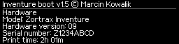
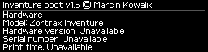

# Inventure boot v1.5 — menu, funkcje i konsola UART

**Stan v1.5-HW2, 29.10.2026:** właściciel potwierdził wgranie na jednej drukarce i poprawny odczyt rzeczywistych danych w Hardware stałego BOOT. Dodatkowe trasy i przypadki awaryjne nie są przez to automatycznie potwierdzone. Wyjątek od trzysekundowego ekranu wyniku: Hardware czeka na świeże OK.


**Wydanie:** `RELEASE 1.5-HW2` · **Autor:** Marcin Kowalik · mkowalik@agh.edu.pl  
**Płyta docelowa:** rozpoznana Inventure V9, STM32F207, Flash 256 KiB. Identyfikację plików podaje [manifest wydania](RELEASE_MANIFEST.md). Procedury wgrywania opisuje [instrukcja instalacji](INSTALACJA_PL.md). [English](FEATURES_AND_CONSOLE_EN.md).

Użytkownik potwierdził wgranie tej poprawionej wersji do drukarki i pomyślny test opcji. Jest to potwierdzenie działania na jego urządzeniu; nie zastępuje osobnych pomiarów elektrycznych ani testów wszystkich sytuacji awaryjnych.

## Start, przyciski i powrót z wyniku

Po inicjalizacji wyświetlacza rozpoczyna się **odliczanie 5 sekund**. Bootloader sprawdza aplikację w pamięci i uruchamia ją, jeśli warunki startu są spełnione. Dowolny przycisk — **GÓRA, OK lub DÓŁ** — przerywa odliczanie i otwiera menu. Uwzględniane jest także naciśnięcie podczas inicjalizacji. Odebrany znak UART również zatrzymuje autostart. Niepoprawna aplikacja, niezgodne warunki sprzętowe lub aktywny recovery zatrzymują automatyczny start.

Sama obecność pliku na karcie **nie uruchamia instalacji** w tym bootloaderze. Automatyczny start dotyczy aplikacji już zapisanej w drukarce.

W menu GÓRA i DÓŁ przesuwają wybór, a OK otwiera pozycję. `Back` jest pierwszą pozycją podmenu i pozostaje widoczne w górnym wierszu podczas przewijania. Przy zaznaczonym `Back` znacznik wskazuje **w lewo**; przy innych pozycjach wskazuje w prawo. Na stronie wybranego pliku powrót nazywa się `Back to files`. Nie ma osobnego przycisku Back.

Zwykły ekran wyniku, np. `OPERATION COMPLETE` / `OK` lub `OPERATION REJECTED` / kod błędu, wraca do menu **automatycznie po 3 sekundach**. W tym czasie klawisze nie wykonują kolejnej operacji. Puść je, poczekaj na menu i dopiero wtedy naciśnij wybraną pozycję ponownie. Nie trzeba zamykać wyniku przyciskiem OK.

| Operacja | Potwierdzenie na panelu | Anulowanie |
| --- | --- | --- |
| Zapis aplikacji z SD lub UART | Puść przyciski, potem trzymaj **OK + GÓRA przez 2 s** | Sam DÓŁ |
| Ręczny start aplikacji | Puść przyciski, potem trzymaj **OK + DÓŁ przez 2 s** | Sama GÓRA |
| `Backup Flash + identity` / `BACKUP` oraz `Save history to SD` / `LOGSAVE` | Puść przyciski, potem **OK + GÓRA przez 2 s**; zapis dotyczy plików SD | Sam DÓŁ |

Potwierdzenia wyświetlają najpierw `RELEASE BUTTONS`. Po puszczeniu pojawia się właściwa kombinacja. Potwierdzenie ręcznego startu nie jest potrzebne przy prawidłowym automatycznym starcie po odliczaniu. Osobna aplikacja instalatora BOOT r9898 ma własne menu, dwa potwierdzenia wymiany BOOT i 5-sekundowe trzymanie — opisano je w instrukcji instalacji.

## Czcionka i przewijanie w v1.5-HW2

BOOT i instalator używają oryginalnej proporcjonalnej czcionki r0323 **bez skalowania**. Nie używaj starszej eksperymentalnej paczki `LARGE_FONT`. Nagłówek: `Inventure boot v1.5 © Marcin Kowalik`.

Menu główne ma cztery widoczne wiersze; podmenu ma przypięty `Back` i trzy przewijane pozycje. UP na początku i DOWN na końcu nie zawijają listy i nie wywołują niepotrzebnego odrysowania. Okno listy jest pamiętane: dopóki wybór mieści się w nim, porusza się tylko wskaźnik; po przekroczeniu krawędzi lista przesuwa się o jeden wiersz. Zmiana kierunku najpierw przesuwa wskaźnik w obecnym oknie. Indeksy listy plików są normalizowane po zmianie długości. `Backup` nie jest mylony z `Back`.

Pierwsza klatka OLED jest pełna; następne wysyłają zmieniony prostokąt, a identyczna klatka nie jest ponownie przesyłana. To opis implementacji, nie pomiar migotania lub opóźnienia fizycznego OLED.


## Pełny układ menu v1.5-HW2

Poniższe nazwy i kolejność odpowiadają wydaniu `RELEASE 1.5-HW2`. Ekrany mają angielskie etykiety, nagłówek `Inventure boot v1.5 © Marcin Kowalik` i proporcjonalną czcionkę bitmapową odzyskaną z oryginalnej aplikacji Zortrax r0323. Zachowano jej piksele i odstępy; bootloader ma własny nagłówek i układ czterech widocznych wierszy. Nie jest to deklaracja identyczności z każdym historycznym ekranem fabrycznego bootloadera.

| Pozycja w menu głównym, w kolejności | Pozycje podmenu, w kolejności |
| --- | --- |
| `Start application` | `Back`, `Launch application` |
| `Firmware on SD` | `Back`, `Check SD package`, `Install firmware`, `Choose firmware file` |
| `Diagnostics` | `Back`, `Verify Flash`, `Hardware`, `Reset / Recovery`, `Clear recovery lock`, `Buttons / raw inputs`, `Display test`, `UART`, `SD card info` |
| `About` | `Back`, `© Marcin Kowalik`, `mkowalik@agh.edu.pl`, `Version v1.5` |
| `Restart` | `Back`, `Restart controller` |
| `Backup Flash` | Strona `Backup to SD`: `Back`, `Backup Flash + identity` |
| `Service history` | `Back`, `View history on UART`, `Save history to SD` |

| Dalsza strona | Pozycje, w kolejności |
| --- | --- |
| `Diagnostics → UART` | `Back`, **`UART test`**, **`P4 baud rate`** |
| `Diagnostics → UART → P4 baud rate` | `Back`, `19200`, `57600`, `115200`, `250000`, `500000` |
| `Firmware on SD → Choose firmware file` | Tytuł `Files - select, then verify`; `Back`, potem znalezione pliki |
| Wybrany plik | Tytułem jest jego nazwa; `Back to files`, `Check selected file`, `Install selected file` |

`UART` znajduje się bezpośrednio **po `Display test` i przed `SD card info`**. Właściwe dwie funkcje UART są w tym podmenu. Weryfikacja obecnej aplikacji to `Diagnostics → Verify Flash`, a start to `Start application → Launch application`. Nazwy `VERIFY` i `BOOT` poniżej oznaczają komendy konsoli.

## Hardware — rzeczywiste dane egzemplarza, tylko odczyt

**Potwierdzone przez właściciela 29.10.2026:** ekran Hardware w stałym bootloaderze poprawnie odczytuje dane jego drukarki. Jest to potwierdzenie na jednym urządzeniu, a nie wyłącznie test modelowy.

Stały BOOT: `Diagnostics → Hardware`. Instalator SD: `Hardware`. Obydwa pokazują:

```text
Model: Zortrax Inventure
Hardware version: <wartość z OTP>
Serial number: <Z i osiem cyfr szesnastkowych>
Print time: <godziny>h <minuty:02d>m
```

Model jest nazwą obsługiwanego profilu. Wersja sprzętowa i numer seryjny pochodzą z **OTP Inventure**; `Print time` to zapisany czas **drukowania** z NVM ID0, a nie całkowity czas zasilania. Nie używa się adresów ani parsera M300. Przy każdym otwarciu następuje ponowny odczyt. Brak wiarygodnego rekordu daje `Unavailable` tylko w danym polu; prawidłowe zero jest pokazywane jako `0h 00m`.

Po wejściu puść OK. Ekran pozostaje do **kolejnego świeżego naciśnięcia OK**, bez limitu trzech sekund i bez przytrzymywania. UP/DOWN nie uruchamiają innych funkcji na tej stronie. Odczyt nie zapisuje NVM/OTP ani ustawień; nie pokazuje kluczy, surowego OTP lub UID. UART `INFO` i kontrola zgodności płyty to odrębne funkcje — nie zastępują tego widoku. W stałym BOOT nie dodano komendy tekstowej `Hardware` ani `MEMORY`.




*Rendery rzeczywistego kodu C, nie fotografie; dane na ilustracjach są syntetyczne, a nie prywatne dane drukarki właściciela.*

## Pliki firmware i instalacja aplikacji

Przeglądarka pokazuje do **16 plików** `.BIN` / `.IVB` z katalogu głównego karty, w granicach obsługiwanych nazw i rozmiarów. Obsługiwane są krótkie nazwy FAT oraz zgodne nazwy ASCII VFAT do 26 znaków. Nie przegląda podkatalogów ani zawartości ZIP. Pliki zarezerwowane na kopie i logi nie są pokazywane jako firmware. Karty FAT16/FAT32 są obsługiwane; do procedur instalacyjnych używaj FAT32. exFAT nie jest obsługiwany.

**Wybranie pliku nie sprawdza jeszcze jego poprawności.** Użyj `Check selected file`, poczekaj na sukces, a następnie osobno wybierz `Install selected file`. Kontrola obejmuje strukturę, wektory i integralność; obsługiwane oryginalne obrazy przechodzą także odpowiednie kontrole kontenera i listy znanych obrazów. Nie każdy plik o rozszerzeniu BIN jest zgodnym firmware.

Rozpoznawane formaty obejmują zgodne pakiety `.IVB`, obsługiwany jawny payload Zortraxa i oryginalne zaszyfrowane pakiety ZRTX `InventureUpdate.bin`. Przed kasowaniem aplikacji wykonywana jest weryfikacja, a po zapisie odczytowa kontrola wyniku. Jeżeli obraz już jest identyczny, ekran pokazuje `ALREADY INSTALLED` / `FLASH WRITE SKIPPED`, a UART `DONE ALREADY_INSTALLED`.

Gdy nie wybrano konkretnego pliku, `Check SD package` / `SDCHECK` i `Install firmware` / `SDUPDATE` korzystają ze standardowych nazw `INVENTUR.IVB`, `InventureUpdate.bin`, `INVENTUR.BIN`. Pozostawienie kilku kandydatów może dać `AMBIGUOUS_FILES`. **`RESTORE.BIN` wybieraj jawnie w przeglądarce** — nie należy do standardowego automatycznego wyboru.

Wybrany plik pozostaje wybrany także po wyjściu przez `Back`; kolejne ogólne `SDCHECK` / `SDUPDATE` nadal go dotyczą. Restart albo `SELECT AUTO` przywraca wybór automatyczny. Po udanej instalacji bootloader wraca do menu; ręczne uruchomienie wykonuje się osobno.

`SDUPDATE` i `UARTUPDATE` zapisują obszar **aplikacji od `0x08010000`**, wraz z jej metadanymi. Nie służą do bezpośredniego wgrywania surowego 32-KiB pliku BOOT. Podczas zwykłej aktualizacji aplikacji BOOT, jego dziennik P4, NVM, OTP i Option Bytes pozostają poza operacją zapisu. Wymianę BOOT opisuje osobna instrukcja. Przerwanie programowania może wymagać odzyskania aplikacji lub interwencji przez SWD; nie ma automatycznego powrotu do drugiego obrazu.

## P4 baud rate — trwałe ustawienie prędkości

Menu **`Diagnostics → UART → P4 baud rate`** oferuje **19200, 57600, 115200, 250000 i 500000 baud**. Domyślna prędkość świeżo wgranego kanonicznego BOOT wynosi **250000**. Parametry pozostałe to **8N1, bez kontroli przepływu**.

1. Wybierz prędkość na panelu i naciśnij OK. Po udanym zapisie prędkość zmienia się od razu; nie ma dodatkowej kombinacji 2 s.
2. Ustaw taką samą prędkość w terminalu. Już odpowiedź `PONG <prędkość> 8N1` i `P4 SAVED` jest wysyłana z nową prędkością.
3. Wyślij `PING`. Na przykład przy 115200 poprawna odpowiedź to `PONG 115200 8N1`, następnie `DONE OK`.
4. Przy kolejnym restarcie lub włączeniu zapisane ustawienie zostanie odtworzone przed pierwszym komunikatem `INFO`. Karta SD nie jest do tego potrzebna.

Prędkość zmienia się z menu OLED; nie ma komendy tekstowej `BAUD`. Nie zaczynaj zmiany w środku wpisywania polecenia lub transmisji. Nieukończona linia konsoli albo zajęta operacja blokuje zmianę jako `BUSY`.

W `INFO` wiersz `P4_BAUD 115200 8N1 SAVED 115200` oznacza aktywną i zapisaną prędkość. Mogą się różnić podczas awaryjnego startu opisanego poniżej.

### Gdy nie pamiętasz zapisanej prędkości

Przytrzymaj **GÓRA + DÓŁ podczas włączania lub resetu**, aż wejdziesz do menu. Ten start użyje **250000 baud**, zachowując dotychczasową wartość w pamięci. Podłącz terminal na 250000 i sprawdź `INFO`. Po zwykłym następnym restarcie wróci wcześniej zapisana wartość. Jeżeli chcesz zapisać 250000 na stałe, wybierz ją świadomie w menu `P4 baud rate`.

### Pojemność pamięci ustawień i ponowne wgranie BOOT

Dziennik ustawienia zajmuje ostatnie **256 bajtów własnego obszaru BOOT**, `0x08007F00–0x08007FFF`. Ma **256 miejsc na zapis zmienionej wartości**. Wybór wartości już zapisanej nie zużywa nowego miejsca. Przerwana próba może zużyć miejsce bez utworzenia poprawnego rekordu, dlatego 256 miejsc nie oznacza gwarancji 256 udanych zmian w każdych warunkach.

Normalna zmiana prędkości dopisuje rekord bez kasowania sektora. Po zapełnieniu nowy wybór jest odrzucany: OLED pokazuje `P4 not saved` / `Settings full`, a UART `ERROR LIST_FULL`. Aktywna i ostatnia poprawnie zapisana wartość pozostają zachowane. Nie ma automatycznego zawijania lub kasowania dziennika.

**Ponowna instalacja kanonicznego obrazu BOOT przez r9898 albo ST-Link resetuje dziennik i przywraca 250000.** Dotyczy to także aktualizacji v1.4 → v1.5-HW2. Zwykła aktualizacja aplikacji go nie kasuje. Surowe kopie pełnych 32 KiB BOOT zawierają także stare ustawienia P4. Zapis prędkości nie modyfikuje fabrycznego NVM, OTP ani Option Bytes.

Ustawienie dotyczy konsoli tego bootloadera. Instalator r9898 zawsze inicjalizuje własne **250000 8N1**; aplikacje Zortrax i Klipper mają własną konfigurację portu. Po przekazaniu im sterowania prompt `INV>` przestaje działać.

## Połączenie konsoli

Bootloader używa **USART6**, z sygnałami **PG14 = TX drukarki** i **PG9 = RX drukarki**, wyprowadzonymi na złącze konsoli P4 używane w projekcie. Łącz sygnały według ich funkcji:

| Sygnał drukarki | Połączenie adaptera UART |
| --- | --- |
| TX drukarki, PG14 | RX adaptera |
| RX drukarki, PG9 | TX adaptera |
| GND | Wspólna masa |

Wymagane są poziomy logiki **3,3 V**. Ta tabela nie określa fizycznej kolejności styków, strony patrzenia na złącze ani numeracji konkretnego adaptera. Ustal je z dokumentacji lub sprawdzonego połączenia danej płyty i adaptera. Nie podłączaj nadajnika 5 V ani poziomów RS-232. Nie zasilaj płyty przewodem VCC adaptera UART; drukarka korzysta ze swojego zasilania.

Terminal ustaw na aktywną prędkość, **8N1, bez kontroli przepływu**. Jako koniec wiersza można użyć LF; v1.5-HW2 przyjmuje również CR i CRLF. Polecenia są zapisane wielkimi literami. Prompt to `INV>`. Echo po stronie bootloadera jest domyślnie włączone, więc dodatkowe lokalne echo terminala daje podwójne znaki. Można je przełączyć poleceniami `ECHO OFF` / `ECHO ON`.

Przykład dla macOS z zainstalowanym pySerial — zastąp nazwę portu rzeczywistą, a prędkość ustawioną na panelu:

```sh
python3 -m serial.tools.miniterm /dev/cu.TWOJ_PORT 250000 --eol LF
```

Dokumentacja terminala: [pySerial miniterm](https://pyserial.readthedocs.io/en/latest/tools.html#serial-tools-miniterm). Wyjście z miniterm: **Ctrl+]**. Tylko jeden program powinien jednocześnie korzystać z danego portu. Po uruchomieniu instalatora przełącz terminal na 250000; po uruchomieniu aplikacji użytkowej nie oczekuj odpowiedzi konsoli BOOT.

**[Praktyczne przykłady konsoli P4: oryginalny zaszyfrowany firmware, odszyfrowana aplikacja i Klipper](KONSOLA_P4_PRZYKLADY_PL.md)** — opis poleceń i transmisji pakietów UART/SD.

## Komendy UART i odpowiedzi

Zwykłe powodzenie jest oznaczone `DONE OK`, błąd `ERROR <kod>`. Większość poleceń kończy się `READY` i promptem `INV>`. `BOOT` i `REBOOT` po powodzeniu przekazują sterowanie lub resetują urządzenie, więc nie oczekuj zakończenia na starym prompcie. W trakcie dłuższych operacji występują dodatkowo wiersze `PHASE` i `PROGRESS`.

| Komenda | Działanie / charakterystyczna odpowiedź |
| --- | --- |
| `HELP` | Lista poleceń; `DONE OK` |
| `INFO` | Wersja, `BUILD RELEASE 1.5-HW2`, tryb, limity APP, stan sprzętu i `P4_BAUD … 8N1 SAVED …` |
| `VERIFY` | Weryfikacja APP w Flash; przy sukcesie `INSTALLED <liczba_bajtów> <nazwa_lub_CUSTOM_MANIFEST>`, potem `DONE OK` |
| `LIST` | Odświeża listę plików: `FILES <liczba> (NOT YET VERIFIED)`, następnie numer, nazwa i rozmiar każdej pozycji |
| `SELECT n` | Wybiera numer **od zera** z ostatniej listy; `SELECTED <nazwa>`, `DONE OK` |
| `SELECT AUTO` | Kasuje jawny wybór; `DONE AUTO_SELECTION` |
| `SDCHECK` | Sprawdza wybrany lub automatycznie znaleziony pakiet; nie zapisuje APP |
| `SDUPDATE` | Instaluje zweryfikowany pakiet po fizycznym potwierdzeniu OK+GÓRA 2 s; identyczny obraz daje `DONE ALREADY_INSTALLED` |
| `BOOT` | Uruchamia poprawną APP po OK+DÓŁ 2 s; przy przejściu `BOOT APPLICATION` |
| `REBOOT` | Restart urządzenia |
| `MENU`, `HOME`, `BACK` | Wszystkie trzy otwierają **menu główne**; UART `BACK` nie oznacza cofnięcia o jedną stronę |
| `ECHO ON`, `ECHO OFF` | Odpowiednio `DONE ECHO_ON`, `DONE ECHO_OFF` |
| `BACKUP` | Kopia Flash i identyfikacji na SD; po udanej weryfikacji `BACKUP VERIFIED: INVFLASH.BIN + INVINFO.BIN` i `DONE OK` |
| `RESETINFO` | Flagi/przyczyna resetu, `BOOT_COUNT`, `WDG_LOOP_COUNT`, `RECOVERY OFF` lub `LATCHED`, `RETENTION WARM_RESET_ONLY` |
| `RECOVERY CLEAR` | Czyści licznik i blokadę recovery; `RECOVERY CLEARED`, `DONE OK`; nie uruchamia APP |
| `DIAG` | Test przycisków, następnie odczyt `RAW_IDR` portów A/C/D/G |
| `DISPLAY` | Test wzorów wyświetlacza |
| `PING` | `PONG <aktywna_prędkość> 8N1`, `DONE OK` |
| `CARDINFO` | Inicjalizacja SD, liczba sektorów `SD_SECTORS` i pojemność `SD_MiB` |
| `LOG` | `HISTORY LAST … OF … EVENTS` oraz wiersze `EVENT` |
| `LOGSAVE` | Zapis historii do przygotowanego `INVLOG.BIN`, po potwierdzeniu na panelu |
| `DUMP FLASH`, `DUMP NVM`, `DUMP OTP`, `DUMP UID`, `DUMP OPTIONS` | Odczyt pamięci w tekstowym formacie HEX opisanym niżej |
| `UARTCHECK N` | Sprawdzenie pakietu długości N bajtów dostarczanego przez hosta protokołem ramkowym |
| `UARTUPDATE N` | Instalacja tak dostarczonego pakietu; nadal wymaga fizycznego potwierdzenia zapisu |

Przy wyborze pliku wykonaj najpierw `LIST`, odczytaj aktualny numer i dopiero wyślij np. `SELECT 1`. Kolejność plików zależy od katalogu karty. **Nie ma polecenia `SELECT RESTORE.BIN` ani `SELECT <nazwa>`**. `SELECT` nie wykonuje weryfikacji; do tego służy `SDCHECK`.

`UARTCHECK` / `UARTUPDATE` są przeznaczone dla programu hosta. Bootloader żąda fragmentów przez `READ <offset> <liczba_bajtów>`, a host odpowiada ramką `IBD1` z offsetem, długością, danymi i CRC32. Nie wysyłaj surowego pliku jako tekstu terminala. Ten protokół wejściowy jest odrębny od tekstowego eksportu `DUMP`.

## DUMP — tekst HEX z kontrolą integralności

`DUMP` jest operacją tylko do odczytu. Zwraca **drukowalny tekst ASCII z danymi zakodowanymi szesnastkowo**, nie gotowy binarny plik. Schemat strumienia wygląda tak; pola w nawiasach oznaczają rzeczywiste wartości, które zwróci urządzenie:

```text
BEGIN_DUMP FLASH 262144
DATA <offset_hex8> <crc32_hex8> <dane_hex>
...
END_DUMP SHA256 <sha256_hex64>
DONE OK
READY
INV>
```

Każdy wiersz `DATA` zawiera do **128 bajtów** danych, czyli do 256 znaków HEX. Offset jest liczony od początku wybranego obszaru, a CRC32 dotyczy bajtów tego fragmentu. Końcowe SHA-256 dotyczy wszystkich bajtów obszaru. Dłuższy eksport, szczególnie całej Flash przy 19200 baud, wymaga czasu na przesłanie całego tekstu.

| Polecenie | Początek obszaru | Liczba bajtów |
| --- | --- | ---: |
| `DUMP FLASH` | `0x08000000` | 262144 |
| `DUMP NVM` | `0x08008000` | 32768 |
| `DUMP OTP` | `0x1FFF7800` | 528, łącznie z bajtami blokad |
| `DUMP UID` | `0x1FFF7A10` | 12 |
| `DUMP OPTIONS` | `0x1FFFC000` | 16 |

Można zachować cały strumień jako log tekstowy. Aby uzyskać poprawny plik `.bin`, odbiornik musi zdekodować tylko pola danych, sprawdzić ciągłość offsetów, pełną długość, CRC32 każdego fragmentu i końcowe SHA-256. Zmiana rozszerzenia logu na `.bin` nie wykonuje tej konwersji. Nie traktuj urwanego strumienia bez pełnej kontroli jako poprawnej kopii. Zrzuty Flash/NVM, OTP i UID mogą zawierać dane indywidualne drukarki; zachowuj je prywatnie.

## Backup Flash i pliki serwisowe SD

`Backup Flash → Backup Flash + identity` albo `BACKUP` zapisuje **aktualny stan** 256 KiB głównej Flash, w tym BOOT, dziennik P4, NVM i APP. Nie musi to być stan fabryczny. Towarzyszą mu dane identyfikacyjne i sumy kontrolne. Pliki wymagają wcześniejszego przygotowania w katalogu głównym FAT32:

| Plik | Dokładny rozmiar | Zawartość po udanej operacji |
| --- | ---: | --- |
| `INVFLASH.BIN` | 262144 B | Cała bieżąca główna Flash |
| `INVINFO.BIN` | 1024 B | UID, OTP z blokadami, odczyt Option Bytes, SHA-256 Flash i kontrola metadanych |
| `INVLOG.BIN` | 4096 B | Eksport historii serwisowej przez `LOGSAVE` |

Świeże pliki przygotowuje się jako szablony wypełnione bajtem **`0xA5`**, o podanych rozmiarach. Ich obecność nie oznacza wykonanego backupu. Bootloader zapisuje istniejące, przydzielone obszary plików; nie tworzy ich, nie rozszerza, nie zmienia nazw ani daty modyfikacji. Brak wymaganego pliku serwisowego daje `PREPARE_SD_FILES`.

Backup dopuszcza sektory A5 lub już zgodne z bieżącą zawartością urządzenia. Inna wcześniejsza kopia jest chroniona przed zastąpieniem i daje `BACKUP_EXISTS`. Najpierw zachowaj ją na komputerze; dopiero potem przygotuj świeże szablony dla nowej kopii. Zmiana prędkości P4 zmienia bajty BOOT, więc wcześniejsza kopia może już różnić się od aktualnej pamięci. Po zapisie następują odczytowa weryfikacja i SHA-256, a metadane zapisywane są na końcu.

`INVLOG.BIN` może zostać zastąpiony kolejnym logiem tego samego urządzenia. Nie jest to nieograniczony dziennik. Po udanych operacjach skopiuj pliki także na inne nośniki. `INVINFO.BIN` jest plikiem metadanych, nie obrazem do programowania mikrokontrolera.

Te pliki są odrębne od **`ZBACKUP.BIN` i `ZBACK2.BIN` po 32768 B**, których aplikacja r9898 używa podczas wymiany BOOT. Nie zamieniaj ich nazw ani ról.

## Diagnostyka, historia i recovery

`Buttons / raw inputs` / `DIAG` pokazuje stany przycisków i odczytuje wejścia GPIO. **Przytrzymanie samego OK przez 1 s** kończy test; ma on także limit 20 s. `Display test` / `DISPLAY` pokazuje wzory OLED: **GÓRA/DÓŁ zmienia wzór, OK kończy**, także z limitem 20 s. `UART test` pokazuje aktywną prędkość i `Send PING`; UART wypisuje `PONG … 8N1`. `SD card info` inicjalizuje kartę i pokazuje jej pojemność. Te funkcje nie są testami ruchu, grzania, kalibracji termistorów ani stopni mocy.

`Reset / Recovery` / `RESETINFO` pokazuje flagi resetu, licznik uruchomień, licznik resetów watchdogiem i blokadę recovery. **Trzy resety watchdogiem po zapisanym przekazaniu sterowania APP** mogą zablokować autostart. `Clear recovery lock` / `RECOVERY CLEAR` świadomie zeruje tę blokadę i licznik, ale nie uruchamia aplikacji. Ręczny start poprawnej APP nadal wymaga zwykłego potwierdzenia. Zanik zasilania, BOR, NRST i zamierzony reset programowy nie są traktowane jak potwierdzona nieudana próba startu. Mechanizm nie wykrywa każdego zawieszenia i nie włącza nowego watchdogu.

Historia przechowuje ostatnie **24 zdarzenia**, numer uruchomienia i czas w milisekundach od jego początku. Korzysta z dwóch kopii stanu z CRC w backup SRAM. Oczekiwana retencja dotyczy restartów bez utraty zasilania; zachowanie po pełnym wyłączeniu nie jest gwarantowane. `LOG` wypisuje historię, a `LOGSAVE` zapisuje jej bieżący zrzut na SD. Nie jest to dziennik z datą i godziną ani pełny zrzut przyczyny awarii.

## Przydatne komunikaty odmowy

| Komunikat | Znaczenie praktyczne |
| --- | --- |
| `NOTFOUND` | Nie znaleziono wymaganego pliku firmware |
| `AMBIGUOUS_FILES` | Niejednoznaczny wybór pliku; usuń zbędnych kandydatów lub jawnie wybierz właściwy |
| `HASH`, `CRC`, `VECTOR`, `FORMAT` | Nieudana kontrola danych, obrazu lub protokołu; nie wymuszaj zapisu |
| `CONFIRM`, `BUTTONS` | Potwierdzenie anulowane, nieukończone lub przyciski nie zostały puszczone |
| `HARDWARE` | Zbiorcza odmowa warunków sprzętowych/zapisu; sam kod nie wskazuje jednej przyczyny |
| `HW_WATCHDOG` | Warunki watchdogu blokują przekazanie sterowania APP |
| `BACKUP_EXISTS` | Istniejąca kopia różni się od bieżącego urządzenia lub obrazu; zachowaj ją przed przygotowaniem nowej |
| `PREPARE_SD_FILES` | Brak przygotowanego pliku serwisowego lub niezgodny szablon logu |
| `LIST_FULL` | W przeglądarce: za dużo plików; przy zmianie P4: zapełniony dziennik, z ekranem `Settings full` |
| `BUSY` | Nie można teraz zmienić prędkości P4, np. przy nieukończonej linii UART |

Przy problemie zachowaj dokładny komunikat, czynność, przy której wystąpił, oraz wynik `INFO`. Ustawienia ochrony MCU nie są zmieniane przez te polecenia.

## Osobny program instalatora — prompt `SD>`

Pośrednik HW2 jest tymczasową APP, nie stałym BOOT i nie firmware drukującym. Menu: **Backup current boot x2; Install / reinstall boot; Hardware; Restart**. Używa zawsze **250000, 8N1** i końca linii **LF**. Obsługuje `INFO`, `MEMORY` (cztery wiersze danych), `BACKUP`, `INSTALL`, `REBOOT`. Polecenia stałego BOOT, np. `SDUPDATE`, nie są poleceniami instalatora.

`INSTALL` wymaga rozpoznanego źródła, poprawnego RESTORE, dwóch zweryfikowanych kopii aktualnego BOOT i warunków sprzętowych/zapisu. Gest jest odrębny od wyboru menu: **puść przyciski → sam OK raz i puść → OK+UP przez 5 s** na prośbę programu. DOWN anuluje. Nie zaczynaj przytrzymania podczas weryfikacji. Po sukcesie przywróć APP przez `RESTORE.BIN` zgodnie z [instrukcją](INSTALACJA_PL.md).

Napis `V1.5 HW2 - HW UNTESTED` i identyfikacja rodziny `r9898 UI-MEM1` są historycznymi tekstami niezmienionego binarium. Aktualny status to potwierdzona przez właściciela instalacja i poprawny odczyt Hardware na jednej drukarce. Wydanie rozpoznaje się przez **RELEASE 1.5-HW2 i pełne SHA-256**, nie samo r9898. Publiczne pakiety nie były przebudowywane po tym potwierdzeniu.


[Publiczne narzędzia / Public tools](../../tools/README.md): [ibtool.py](../../tools/ibtool.py), [vendor_tool.py](../../tools/vendor_tool.py).
