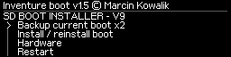
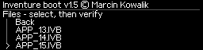
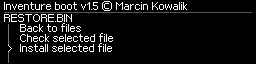
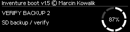
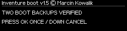
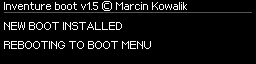
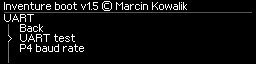
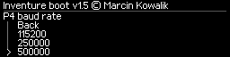

# Inventure boot v1.5-HW2 — pełna instrukcja instalacji

**Wydanie:** v1.5 · **BUILD:** RELEASE 1.5-HW2 · **Data publikacji:** 29.10.2026  
**Cel:** Inventure V9 / STM32F207 / 256 KiB Flash. Autor: Marcin Kowalik.

[Projekt](../../README.md) · [English](INSTALLATION_EN.md) · [Funkcje/P4](FUNKCJE_I_KONSOLA_PL.md) · [Manifest](RELEASE_MANIFEST.md) · [Archiwum v1.4](../v1.4/INSTALACJA_PL.md)

Właściciel potwierdził poprawną instalację i działanie na **jednej drukarce**. Nie zmieniono binariów po tej próbie. Nie wyszczególnił osobno wyników wszystkich trzech metod. Banner instalatora `HW UNTESTED` pochodzi z kompilacji sprzed próby; pozostał, aby zachować identyczne pliki.

**Hardware — potwierdzone na urządzeniu:** 29.10.2026 właściciel dodatkowo potwierdził, że ekran Hardware w stałym bootloaderze **poprawnie odczytuje rzeczywiste dane jego drukarki**. Nie jest to jedynie wynik testu modelowego. Ilustracje w instrukcji nadal zawierają jawnie syntetyczne dane przykładowe; nie są zrzutem prywatnych danych użytkownika.

## Nawigacja

[FROM FACTORY](#factory) · [UPGRADE](#upgrade) · [Wspólny etap SD i RESTORE](#instalator) · [ST-Link](#stlink) · [Konsola P4](FUNKCJE_I_KONSOLA_PL.md) · [Przykłady APP](KONSOLA_P4_PRZYKLADY_PL.md)

## 1. Wybór zestawu

| Obecny stan | Plik | Procedura |
|---|---|---|
| Rozpoznany własny BOOT, w tym wydana v1.4 | [SD_UPGRADE](../../firmware/v1.5/Inventure_boot_v1.5_HW2_STOCK_FONT_2026-10-29_SD_UPGRADE.zip) | B, potem C |
| Dokładnie rozpoznany fabryczny BOOT V9 i potwierdzone warunki zapisu | [SD_FACTORY_V9 / FROM FACTORY](../../firmware/v1.5/Inventure_boot_v1.5_HW2_STOCK_FONT_2026-10-29_SD_FACTORY_V9.zip) | A, potem C |
| Bezpośredni sprawny odczyt/zapis SWD | [ST-Link BIN](../../firmware/v1.5/Inventure_boot_v1.5_HW2_STOCK_FONT_2026-10-29_STLINK_32KiB_0x08000000.bin) | D |

Nie używaj paczek M300, M200, Plus ani Dual. Sam napis wersji nie potwierdza zgodności źródła; instalator porównuje tożsamość obrazu. Paczki z nazwami LARGE_FONT lub UI-MEM1 nie są tym wydaniem HW2.

## 2. Przed rozpoczęciem

Zachowaj **pełną, zweryfikowaną kopię własnego urządzenia**, a nie tylko pobrany oryginalny firmware. Kopia 256 KiB Flash obejmuje BOOT, NVM i APP; odczyty OTP/UID/Option Bytes zachowaj oddzielnie. Kopie są prywatne i należy przechowywać je także na drugim nośniku. Dwa pliki `ZBACKUP.BIN` / `ZBACK2.BIN` dołączone do SD są początkowo **szablonami**, nie wykonanymi kopiami.

Przed drogą SD sprawdź zgodność płyty, **RDP Level 0**, brak ochrony zapisu sektorów **0–1 (BOOT)** i **4–5 (APP)**, odpowiedni `RESTORE.BIN` i stabilne zasilanie. Fabryczny referencyjny BOOT ma 32768 B i SHA-256 `19640ae302d918a79a243dbc7a5efcf055f78a1b459af4b50f3e66575af81752`. Własne wcześniejsze obrazy muszą być rozpoznawane przez instalator. P4 journal może się różnić jedynie dla rozpoznanych niezmiennych prefiksów.

**Nie używaj Mass Erase, Read Unprotect, `-rdu` ani zmian Option Bytes. Nie obchodź odmów.** Droga factory najpierw zastępuje APP pośrednikiem; późniejsza odmowa wymiany BOOT nie cofa tego automatycznie. Zanik zasilania podczas kasowania/programowania BOOT może wymagać SWD. Nie ma automatycznego A/B rollbacku.

| Obszar | Zakres | Zwykła instalacja BOOT przez SD | ST-Link według instrukcji |
|---|---|---|---|
| BOOT, sektory 0–1 | `0x08000000–0x08007FFF` | Wymieniany przez pośrednik | Wymieniany bezpośrednio |
| Dziennik P4, część BOOT | `0x08007F00–0x08007FFF` | Odnawiany, domyślnie 250000 | Odnawiany |
| NVM, sektory 2–3 | `0x08008000–0x0800FFFF` | Zachowane | Zachowane i porównywane |
| APP/metadane, sektory 4–5 | `0x08010000–0x0803FFFF` | Pośrednik, następnie przywrócenie APP | Zachowane i porównywane |

## 3. Sumy i karta SD

Pobierz [SHA256SUMS.txt](../../firmware/v1.5/SHA256SUMS.txt). Porównaj wszystkie 64 znaki sumy wybranego pliku, np. `shasum -a 256 NAZWA_PLIKU` na macOS, `sha256sum NAZWA_PLIKU` na Linux lub `Get-FileHash -Algorithm SHA256 NAZWA_PLIKU` w PowerShell. Niezgodność oznacza przerwanie procedury.

Rozpakuj **jeden** ZIP na komputerze. Na kartę **FAT32**, do katalogu głównego, skopiuj cztery pliki:

| UPGRADE | FROM FACTORY | Znaczenie |
|---|---|---|
| `INVENTUR.IVB` | `InventureUpdate.bin` | Pośrednik instalacyjny dla wybranej drogi |
| `RESTORE.BIN` | `RESTORE.BIN` | Oryginalna APP Zortrax 1.6.1/r0323 |
| `ZBACKUP.BIN` | `ZBACKUP.BIN` | Pierwszy przydzielony plik kopii BOOT, 32768 B |
| `ZBACK2.BIN` | `ZBACK2.BIN` | Drugi przydzielony plik kopii BOOT, 32768 B |

Nie kopiuj ZIP-a bez rozpakowania, prywatnego KOMPLETU ani surowego pliku ST-Link. Nie mieszaj dwóch instalatorów na jednej karcie. `ZBACKUP.BIN` i `ZBACK2.BIN` ze świeżego ZIP-a są wypełnione A5; **nie zastępuj nimi już wykonanych kopii**. Zachowaj poprzednie pliki na komputerze, użyj oddzielnej przygotowanej karty. Bezpiecznie wysuń kartę z systemu.

<a id="factory"></a>

## 4. A — FROM FACTORY — oryginalny bootloader Zortrax

1. Wykonaj wymagania rozdziałów 1–3 **przed włożeniem karty**, w szczególności odczyt i zabezpieczenie własnych danych oraz sprawdzenie ochrony pamięci.
2. Wyłącz drukarkę. Włóż kartę z **SD_FACTORY_V9**, zawierającą `InventureUpdate.bin`.
3. Włącz drukarkę; zgodny fabryczny bootloader obsługuje plik aktualizacji i zapisuje pośrednik jako aplikację. Nie przerywaj tego etapu i nie wyjmuj karty.
4. Oczekuj menu **`SD BOOT INSTALLER - V9`**, a nie menu aplikacji drukującej. Nagłówek `Inventure boot v1.5` w pośredniku **nie dowodzi jeszcze podmiany BOOT**.
5. Kontynuuj dokładnie rozdział C: dwie kopie, osobne potwierdzenie, zapis BOOT, restart i przywrócenie APP.



To render kodu instalatora, nie fotografia ani dowód osobnego testu drogi factory.

Jeżeli pozostał oryginalny ekran lub wystąpiła odmowa, nie zgaduj, że instalacja zakończyła się sukcesem. Sprawdź zestaw, format FAT32, zgodność źródła i komunikat. Nie wymuszaj zapisu zmianą ochrony.

<a id="upgrade"></a>

## 5. B — UPGRADE — istniejący własny bootloader

1. Przygotuj kartę z **SD_UPGRADE** zgodnie z rozdziałem 3.
2. Włącz lub zrestartuj drukarkę i zatrzymaj **5-sekundowy autostart** przyciskiem. Własny BOOT nie instaluje pliku tylko dlatego, że jest on obecny na SD.
3. W v1.3/v1.4/v1.5 wybierz `Firmware on SD → Choose firmware file → INVENTUR.IVB → Check selected file`.
4. Po poprawnym wyniku wybierz `Install selected file`. **Puść przyciski**, a na prośbę trzymaj **OK+UP przez 2 s**. Sam DOWN anuluje. Ten etap zapisuje pośrednik w APP, **jeszcze nie BOOT**.
5. Po zakończeniu wybierz `Start application → Launch application`. Puść przyciski, następnie na prośbę trzymaj **OK+DOWN przez 2 s**. Sam UP anuluje start.
6. Po pojawieniu się `SD BOOT INSTALLER - V9` przejdź do C.




Ilustracje pokazują renderer HW2; wygląd starszego BOOT może być inny. W v1.2 bez przeglądarki użyj `Check SD package` i `Install firmware` przy **jednym** poprawnym standardowym pliku `INVENTUR.IVB`; opcja startu może nazywać się `Start firmware`. Przy pomocy konsoli: `SDCHECK`, następnie `SDUPDATE`, potem `BOOT` z tymi samymi fizycznymi potwierdzeniami. Indeks `SELECT n` zawsze pochodzi z bieżącego `LIST`, a nie z przykładu.

<a id="instalator"></a>

## 6. C — Wspólny etap obu kart — rzeczywista podmiana BOOT

### C1. Dwie kopie starego BOOT

W menu pośrednika wybierz **`Backup current boot x2`** i poczekaj na zakończenie zapisu oraz weryfikacji. Program sprawdza także plik przywracania APP. Sukces oznaczają komunikaty **`TWO SD COPIES VERIFIED` / `SELECT INSTALL SEPARATELY`**, a gdy kopie już pasują — **`TWO BOOT BACKUPS VERIFIED`**.



Inna wcześniejsza kopia nie zostaje bezwarunkowo nadpisana. `Hardware` nie jest kopią pamięci, a napis `MCU... YES` nie zastępuje poprawnej weryfikacji obu plików.

### C2. Osobne potwierdzenie wymiany

Wybierz **`Install / reinstall boot`**. Program sprawdza źródło, obie kopie, plik RESTORE i warunki zapisu. Dopiero na prośbę:

1. Puść wszystkie przyciski.
2. Naciśnij **sam OK raz i puść**. DOWN anuluje.
3. Po wyświetleniu drugiego potwierdzenia trzymaj **OK+UP przez pełne 5 s**. DOWN anuluje. Nie trzymaj kombinacji od początku weryfikacji i nie traktuj pierwszego kliku wyboru jako potwierdzenia.
4. Po zaakceptowaniu program ponownie sprawdza warunki i rozpoczyna zapis. **Nie odłączaj zasilania ani karty**. Przyciski można puścić po zaakceptowaniu gestu.



Na czas programowania, gdy brak wiarygodnego zakresu procentowego, może być `--`. Postęp dotyczy nazwanej bieżącej fazy, nie całej instalacji. Błąd nie oznacza zakończenia na 100%.

### C3. Restart oraz przywrócenie APP — obowiązkowe

Po sukcesie pojawia się `NEW BOOT INSTALLED` / `REBOOTING TO BOOT MENU` i następuje restart. **Przerwij odliczanie**, bo w APP nadal znajduje się pośrednik. Pozostaw kartę.



W nowym BOOT wybierz `Firmware on SD → Choose firmware file → RESTORE.BIN → Check selected file`. Po sukcesie wybierz `Install selected file` i potwierdź **OK+UP 2 s**. Następnie `Diagnostics → Verify Flash`. Dopiero po powodzeniu uruchom `Start application → Launch application` (**OK+DOWN 2 s**).

`RESTORE.BIN` trzeba wybrać jawnie: nie należy do automatycznych nazw aktualizacji. Konsolowo użyj `LIST`, `SELECT n` dla RESTORE, `SDCHECK`, `SDUPDATE`, `VERIFY`, `BOOT`. Nie ma komendy `SELECT RESTORE.BIN`.

Dołączony RESTORE przywraca **Zortrax 1.6.1/r0323**. Nie jest kopią dowolnej aplikacji wcześniej zainstalowanej w drukarce. Własną APP, np. odpowiednio przygotowanego Klippera, przywraca się jako osobno sprawdzony pakiet; nie zmienia to konieczności zakończenia etapu pośrednika. Zabezpiecz wykonane kopie BOOT na komputerze.

<a id="stlink"></a>

## 7. D — ST-Link / SWD — tylko BOOT, bez podmiany APP

1. Wyłącz zasilanie na czas łączenia przewodów. Użyj zidentyfikowanego złącza SWD konkretnej płyty: **SWDIO ↔ SWDIO, SWCLK ↔ SWCLK, GND ↔ GND, odniesienie napięcia docelowego według instrukcji swojego programatora**; NRST tylko zgodnie z jego dokumentacją. Nie zgaduj numerów styków. Nie łącz wyjścia zasilania adaptera z zasilaną drukarką.
2. W STM32CubeProgrammer wybierz **ST-LINK / SWD**, połącz się z prawidłowo zasiloną płytą i zatrzymaj MCU. Sprawdź identyfikację MCU oraz rozmiar Flash **256 KiB**. Odczytaj stan ochron; niczego nie zmieniaj. Przy odmowie odczytu/zapisu przerwij, bez Read Unprotect/Mass Erase.
3. Odczytaj `0x08000000`, długość **`0x40000`**, do dwóch różnych plików. Porównaj ich pełne bajty/SHA-256; zachowaj zgodne kopie. Osobno zabezpiecz dostępne dane OTP i opcji. Ustal, że obecna APP nadaje się do zachowania.
4. Otwórz nowy **BIN 32768 B** wskazany na początku. Adres zapisu: **`0x08000000`**. Wybierz kasowanie **wyłącznie sektorów 0 i 1**. Nie zaznaczaj 2–5 ani pełnego kasowania. Programuj i wykonaj Verify.
5. **Przed uruchomieniem MCU** odczytaj ponownie całe 256 KiB do `after.bin`. Pierwsze 32768 B muszą być identyczne z nowym BIN. Wszystko od offsetu `0x8000` do końca musi być identyczne z kopią `before.bin`.
6. Dopiero po obu zgodnościach zresetuj/uruchom płytę, przerwij autostart i sprawdź `INFO`, Hardware oraz `Verify Flash`. W tej metodzie APP nie była zastępowana pośrednikiem, więc **nie wgrywaj RESTORE bez potrzeby**.

Przykład niezależnego porównania **plików na komputerze**, bez programowania drukarki:

```python
from pathlib import Path
before = Path('before.bin').read_bytes()
after = Path('after.bin').read_bytes()
boot = Path('Inventure_boot_v1.5_HW2_STOCK_FONT_2026-10-29_STLINK_32KiB_0x08000000.bin').read_bytes()
if len(before) != 0x40000 or len(after) != 0x40000 or len(boot) != 0x8000:
    raise SystemExit('BLEDNY ROZMIAR — nie uruchamiaj drukarki')
if after[:0x8000] != boot:
    raise SystemExit('BOOT NIEZGODNY — nie uruchamiaj drukarki')
if after[0x8000:] != before[0x8000:]:
    raise SystemExit('NVM/APP ZMIENIONE — przerwij procedure')
print('PASS: BOOT zgodny, NVM i APP zachowane')
```

Porównanie należy zrobić przed zmianą baud lub uruchomieniem APP, ponieważ te późniejsze czynności mogą legalnie zmienić dziennik P4 albo NVM. Surowy plik ST-Link nie jest pakietem APP do `SDUPDATE`.

## 8. Ustawienie P4 i kontrola po instalacji

Świeżo zapisany BOOT startuje na **250000, 8N1**. Wybierz własną prędkość w `Diagnostics → UART → P4 baud rate`: **19200, 57600, 115200, 250000, 500000**. Dopasuj terminal natychmiast po wyborze. Zapis jest trwały, również bez SD. **UP+DOWN przy starcie** wymusza tylko na ten start 250000, bez nadpisania zapisanego wyboru. Instalator zawsze ma własne stałe 250000.




`INFO` w nowym stałym BOOT powinno zawierać **`BUILD RELEASE 1.5-HW2`**. W `Diagnostics → Hardware` dane są pobierane z drukarki; ekran pozostaje do świeżego OK. Porównaj dane z własnym egzemplarzem. `Print time` oznacza zapisany czas drukowania. Sprawdź końce list, powrót Back i zmianę kierunku. Zachowaj rezultat i dokładny komunikat przy problemie.

## 9. Odmowy i częste pomyłki

| Objaw | Co zrobić |
|---|---|
| Ponownie uruchamia się instalator | Po BOOT update nadal trzeba jawnie zainstalować RESTORE.BIN i wykonać VERIFY |
| `UNRECOGNIZED BOOT IMAGE` | Przerwij; wersja tekstowa nie wystarcza, nie usuwaj kontroli tożsamości |
| `HASH`, `CRC`, `FORMAT`, `VECTOR`, `CHANGED` | Sprawdź właściwy pakiet, sumę i nośnik; nie wymuszaj zapisu |
| `CONFIRM`, `BUTTONS` | Puść klawisze i wykonaj gest dopiero na prośbę; nie podczas wcześniejszej kontroli |
| `HARDWARE`, `FLASH` | Sprawdź warunki sprzętu/zapisu, bez zmieniania ochron w celu obejścia odmowy |
| `AMBIGUOUS_FILES`, `NOTFOUND` | Jeden właściwy zestaw w katalogu głównym FAT32; wybór pliku przez LIST/SELECT |
| `DONE ALREADY_INSTALLED` | APP identyczna, zapis celowo pominięty; nie jest to błąd |
| Hardware pokazuje `Unavailable` | Brak wiarygodnego rekordu danego pola; nie wpisuj wartości na stałe |
| Brak odpowiedzi P4 po BOOT | APP przejęła port i ma własny protokół; konsola INV> już nie działa |

**v1.4 pozostaje archiwum**, a nie gwarantowaną procedurą downgrade z HW2. Starszy instalator może nie rozpoznawać nowego BOOT. Nie obchodź tego zabezpieczenia.

Wszystkie ilustracje pochodzą z renderera HW2 i zawierają tylko dane testowe. Fizyczne potwierdzenie użytkownika odnosi się do jednej drukarki; nie obejmuje prób zaniku zasilania ani osobnej kwalifikacji każdej metody.
